# T11 四个基础模块

## 本章总览

### 解决什么

自然语言最初是一串离散的词元编号，例如 `[12, 7, 12]`。神经网络不能直接拿编号大小做有意义的加减乘除：编号 12 并不代表它比编号 7“更像”什么。因此，模型需要先把编号换成可以学习的向量，再反复加工这些向量，同时保留原来的信息，并控制每个位置的数值尺度。

Llama（Large Language Model Meta AI）是目前主流的开源大型语言模型架构。它之所以能理解并生成文本，核心在于其内部堆叠了数十层被称为“解码器块”（Decoder Block）的结构。

本实验（T11）的目的并非从零训练一个大模型，而是将 Llama 解码器块中最基础的 **4 个底层积木**拆解出来，通过在纯 CPU 上追踪每一行代码的张量计算，观察一段文本究竟是如何变成连续的数学向量，又如何在网络中被放大、筛选并保留记忆的。只有彻底搞清这些积木内部的形状（Shape）变化与参数分布，才能真正理解大型自然语言处理系统的第一性原理。

## 架构全景

Llama 采用纯解码器（Decoder-only）架构。离散词表索引先经由 **Embedding** 映射为稠密隐藏向量，随后输入堆叠的 **Decoder Block**。

单个 Decoder Block 内包含两条并行的计算主线与跨越其上的 **Residual 主传送带**：

1. **注意力子层**：输入经过 **RMSNorm** 稳定数值后计算注意力，结果通过残差连接与原输入相加。
2. **前馈网络子层**：再次经过 **RMSNorm** 规范化，送入 **SwiGLU** 激活门控网络进行非线性变换，结果再次经由残差连接相加。

本章研究 Decoder Block（解码器块）里四种基础操作各自解决什么问题、它们的输入输出形状如何衔接、可训练参数存在哪里，以及公式怎样对应到真实 `forward`（前向计算）代码：

| 模块 | 它要解决的问题 | 生活类比 | 本章观察的输出 |
| --- | --- | --- | --- |
| Embedding（嵌入查表） | 把离散词元编号变成可学习的连续特征 | 查词典编号对应的“人物档案卡” | 每个 token（词元）得到 D 个特征 |
| RMSNorm（Root Mean Square Layer Normalization，均方根层归一化） | 避免某个位置的特征整体过大或过小 | 调整一张卡上所有数值的整体音量 | 每个位置独立归一化，形状保持不变 |
| SwiGLU（Swish-Gated Linear Unit，Swish 门控线性单元） | 让模型扩展特征后按内容动态筛选，再压回原宽度 | 一条通道判断“开多大门”，另一条通道递送内容 | D→F→D，gate 与 up 两条分支相乘 |
| Residual（残差加法） | 把原有表示直接保留下来，并叠加本层学到的更新 | 在旧档案上增补新信息，不必重写整张卡 | 两输入必须同形，输出仍为 `[B,S,D]` |

本章的主问题可以用一句话概括：**如何把词元编号变成 `[B,S,D]`，让两类子层在这个固定宽度上加工信息，同时保证每条残差支路能够逐元素相加？**

想象 Llama 的 Decoder Block 是一个高度自动化的**信息加工厂**，输入的句子是一串写着编号的“货物箱”。为了让两类核心加工站（注意力机制和多层感知机）能在这个固定宽度的主流水线上反复加工信息，且新老特征不冲突，流水线经历了以下四个环节：

1. **Embedding（提档）**：根据编号，把纸片换成厚厚的“专属档案卡”。
2. **RMSNorm（音量控制）**：在交给专家处理前，统一调整档案卡上所有数据的“音量大小”，防止数值爆炸。
3. **SwiGLU（智能门控）**：信息加工站。一条通道负责读取内容，另一条负责判断内容的价值（开多大门），两者结合提取出高维特征，再压缩回原来的尺寸。
4. **Residual（主传送带）**：为防止加工出错导致原意丢失，原来的档案卡一直在主传送带上直通，加工站得出的“新见解”会直接贴（相加）到旧卡片上。

### 架构图

下图按 Llama Decoder Block（Llama 解码器块）的真实数据流画出上下文。粗略的整层流程用于定位 T11 四个模块；Attention（注意力机制）内部细节已在 B03 学习，RoPE（Rotary Position Embedding，旋转位置嵌入）与 KV cache（Key-Value cache，键值缓存）不在 T11 实现范围内。

```mermaid
flowchart LR
    %% ===== 节点定义 =====
    IDs["输入词元编号<br/>[B,S]"]
    EMB["Embedding 查表<br/>[V,D] 参数表"]
    X0["隐藏状态 X0<br/>[B,S,D]"]

    N1["RMSNorm 1<br/>按最后 D 轴归一化"]
    ATT["因果自注意力<br/>B03 已学，T11 不实现"]
    ADD1((逐元素加法 1))

    X1["更新后的隐藏状态 X1<br/>[B,S,D]"]

    N2["RMSNorm 2<br/>按最后 D 轴归一化"]
    GATE["gate 投影<br/>D→F"]
    SILU["SiLU 激活"]
    UP["up 投影<br/>D→F"]
    MUL((逐元素相乘))
    DOWN["down 投影<br/>F→D"]
    ADD2((逐元素加法 2))

    X2["本层输出<br/>[B,S,D]"]
    NEXT["下一层；最后一层后做最终 RMSNorm"]

    %% ===== 主流程 =====
    IDs --> EMB
    EMB --> X0

    subgraph LAYER["一个 Llama Decoder Layer（解码器层）"]
        direction LR

        X0 --> N1
        N1 --> ATT
        ATT --> ADD1
        X0 -. 残差直通 .-> ADD1
        ADD1 --> X1

        X1 --> N2
        N2 --> GATE
        GATE --> SILU
        N2 --> UP
        SILU --> MUL
        UP --> MUL
        MUL --> DOWN
        DOWN --> ADD2
        X1 -. 残差直通 .-> ADD2
    end

    ADD2 --> X2
    X2 --> NEXT

    %% ===== 样式分类 =====
    classDef key fill:#e7f3ff,stroke:#2878b5,stroke-width:2px,color:#102a43;
    classDef norm fill:#f3e8ff,stroke:#8250a8,color:#30203e;
    classDef residual fill:#fff1d6,stroke:#c47a00,stroke-width:2px,color:#4b3300;

    class EMB,GATE,SILU,UP,MUL,DOWN key;
    class N1,N2 norm;
    class ADD1,ADD2 residual;
```



读图时沿箭头看“数据怎么变”，看虚线看“旧值从哪里绕过子层直接抵达加法点”。关键约束是两个加法点的两侧都要是 `[B,S,D]`：RMSNorm 不改形状；SwiGLU 虽然中间变成 F 维，但 down 投影会恢复 D；注意力的输出也必须回到 D。少了 down 投影、或把 attention 输出留在另一个宽度，就不能直接与旧隐藏状态相加。

### 阅读路线

| 顺序 | 追踪内容 | 对应代码 | 读完能解释什么 |
| --- | --- | --- | --- |
| 1 | 整数 ID 如何变成向量 | `embedding.py` 的 `TokenEmbedding.forward` | 为什么输入必须是整数、为什么输出多出 D 轴 |
| 2 | 新旧向量如何合并 | `residual.py` 的 `ResidualAdd.forward` | 为什么两侧必须同形、残差模块为什么没有权重 |
| 3 | 每个 token 如何单独调整尺度 | `rmsnorm.py` 的 `RMSNorm.forward` | `dim=-1` 具体归约哪一轴、epsilon 放在哪里 |
| 4 | 一个 token 的特征如何经过门控 MLP | `swiglu.py` 的 `SwiGLU.forward` | gate/up/down 分别做什么、F 为什么最后还要变回 D |
| 5 | 把公式、代码与证据对上 | `test_t11.py` | 每项 shape、数值和参数计数由哪个断言检查 |

本章属于 B04 Decoder Block（解码器块）第一个任务。四个模块可独立运行，目的是先看懂模型块里的基础积木，再由 T12、T13 接起来。T11 不拼装完整 Decoder Block；Attention（注意力）内部在 B03 学过，RoPE（Rotary Position Embedding，旋转位置嵌入）和 KV cache（Key-Value cache，键值缓存）留到后续任务。统一 CPU reference 检查在 `test_t11.py`。

### 形状总线

先固定一个小模型想象：批大小 `B=1`，句长 `S=3`，模型宽度 `D=4`，SwiGLU 中间宽度 `F=6`。词元 ID `[2,5,2]` 先查表得到 `[1,3,4]`；进入 Decoder Layer（解码器层）后，RMSNorm 和 Attention 都保留 `[1,3,4]`；前馈网络内部暂时扩到 `[1,3,6]`，再压回 `[1,3,4]`；残差两次相加都在 `[1,3,4]` 上完成。

| 数据位置 | 示例 shape | 这一步究竟改变了什么 |
| --- | --- | --- |
| 输入 `input_ids` | `[1,3]` | 三个编号，没有连续特征轴 |
| 嵌入表查找后 | `[1,3,4]` | 每个编号换成四个可学习特征 |
| RMSNorm 后 | `[1,3,4]` | 数值尺度改变，轴和元素数量不变 |
| Attention 后 | `[1,3,4]` | 每个 token 混合序列信息；模型宽度仍为四 |
| SwiGLU gate/up | 各 `[1,3,6]` | 每个 token 临时产生六个中间特征 |
| SwiGLU down 后 | `[1,3,4]` | 六个中间特征重新组合成四维更新 |
| 第二次残差后 | `[1,3,4]` | 将更新叠加回进入前馈层前的隐藏状态 |

可以把 D 想成整条流水线的“接口宽度”：子层内部可以临时扩宽，但出口要回到 D，才能和绕行保存下来的原输入接起来。RMSNorm 调整数字，不改变接口宽度；Residual（残差连接）检查并保持接口宽度。

资料：R01 [Build the Neural Network](https://docs.pytorch.org/tutorials/beginner/basics/buildmodel_tutorial.html) 中的 `nn.Module`、`__init__`、`forward`、子模块参数注册；R05 [Llama 文档](https://huggingface.co/docs/transformers/main/en/model_doc/llama) 与 [modeling_llama.py](https://github.com/huggingface/transformers/blob/22cfdfaad99038416b56d21e35b0d32d4f4ee2d3/src/transformers/models/llama/modeling_llama.py)。源码于 2026-10-13 读取并以 Transformers commit `22cfdfaad99038416b56d21e35b0d32d4f4ee2d3` 固定。Llama 配置声明 `hidden_act="silu"`、`rms_norm_eps=1e-6`、`mlp_bias=False`；模型可以覆盖这些配置，本实验明确采用这些配置值。

## 前置基础

### 张量形状

Tensor（张量）是按多个轴组织的数值。记批大小为 $B$、序列长度为 $S$、词表大小为 $V$、模型宽度为 $D$、前馈宽度为 $F$。隐藏状态（hidden states，层与层之间传递的 token 特征）形状通常是 `[B,S,D]`；每一行/位置对应一个 token，每个 token 有 D 个特征。token ID 输入是 `[B,S]` 的整数张量。

### 模块参数

`nn.Module`（PyTorch 神经网络模块基类）负责登记子模块与其状态。`nn.Parameter`（可训练参数张量）赋值给模块属性后会自动出现在 `parameters()` 和 `state_dict()` 中；普通 Tensor 属性不会自动成为可训练参数。`__init__` 建立参数，`forward` 定义张量如何流过模块。调用 `module(x)` 会进入 PyTorch 的模块调用逻辑并调度 `forward(x)`，因此用 `module(x)` 而不是手动调用 `module.forward(x)`。

### 线性层

Linear（线性层）对输入最后一轴应用矩阵乘法，并可加偏置。权重形状为 `[out_features,in_features]`。输入 `[B,S,D]`、输出宽度 F 时，输出为 `[B,S,F]`；B、S 两轴保持，只有最后一轴改变。

### 残差

Residual connection（残差连接）把模块变换 $f(x)$ 与原输入 x 相加。逐元素加法要求两个张量形状一致；本章不做投影或广播来掩盖不匹配。残差路径本身没有权重，梯度可以沿恒等的 skip path（跳连路径）直接回到输入。

### 均方根

Root mean square（均方根）是先平方、对选定轴取平均、再开平方。RMSNorm 不减均值，也不计算中心化方差；它只用特征向量的均方根做尺度归一化，再乘逐特征可训练缩放向量。

### 门控激活

SiLU（Sigmoid Linear Unit，Sigmoid 线性单元，也称 Swish）先以 Sigmoid（逻辑函数）形成连续门值，再乘回输入。SwiGLU 有 gate（门控）与 up（内容）两个独立线性分支，门控分支经 SiLU 后与内容分支逐元素相乘，最后由 down（降维）线性层投回模型宽度。

## 公式推导

### Embedding

**解决什么问题**：自然语言最初是一串离散的词元编号（例如 `[12, 7, 12]`）。神经网络无法直接对编号大小做有意义的加减乘除——编号 12 并不代表它比 7“更像”什么。Embedding 将离散代号转化为包含连续语义特征的高维向量。

**生活类比**：就像大学里的“学号”。学号 `202601` 和 `202602` 不能直接相加，但拿着学号去教务处数据库查表（Embedding Table），就能拿到对应学生的“身高、体重、统计学成绩”等多维特征卡片。

嵌入表 E 的行号对应词元编号，每行是该词元的 D 维可训练向量：

$$
E\in\mathbb{R}^{V\times D}
\quad\text{（定义：V 个词元各存一行 D 维向量）}
$$

给定整数 ID 张量 I，逐个 ID 取 E 的同编号行：

$$
X_{b,s,:}=E_{I_{b,s},:}
\quad\text{（查表定义：位置 $(b,s)$ 选择第 $I_{b,s}$ 行）}
$$

因此 `[B,S]` 映射为 `[B,S,D]`，元素数随 S、D 增长，但唯一参数只有 `V*D` 个。Embedding 是离散索引查表，不是对 token ID 做线性插值。

### 残差

**解决什么问题**：随着神经网络加深，信息在多层传递中极易失真。残差连接确保即使后续的网络层什么都没学到，最原始的输入信息也能通过“捷径”无损向后传递。

**生活类比**：在旧档案上增补“便利贴”。我们不需要擦除整张卡片重写，而是把新加工出的补充信息直接贴在原卡片上。

设输入 $X\in\mathbb{R}^{B\times S\times D}$，子层结果为 $F(X)$。为逐元素相加，F(X) 必须有与 X 完全相同的 B、S、D：

$$
Y=X+F(X)
\quad\text{（逐元素加法定义：两操作数同形）}
$$

于是输出仍为 `[B,S,D]`。如果 Attention（注意力）或 MLP（Multi-Layer Perceptron，多层感知机）输出宽度不同，必须先由显式投影映射回 D；本实验选择直接拒绝形状不一致。残差加法没有 Parameter，参数量为 0。

Llama decoder layer（Llama 解码器层）的真实顺序是 pre-norm（前置归一化）：先保存残差，再做 RMSNorm 和 Attention（注意力），然后相加；接着重新保存残差，再做 RMSNorm 和 MLP，然后再相加。Norm 与 Attention/MLP 有参数，单纯加法没有参数。

### RMSNorm

**解决什么问题**：在连续的矩阵乘法中，特征向量的数值可能会急剧扩大或缩小。RMSNorm 负责将每个 token 的特征数值缩放到合理的区间，保障训练稳定性。它比传统的 LayerNorm 省去了计算中心化均值的步骤，速度更快。

**生活类比**：会议室麦克风的“自动增益与均衡器”。如果某人的声音过大（数值激增），系统会根据他的整体音量（均方根）自动调小基准音量；调到标准后，再交由调音台的均衡器（可训练参数 $\gamma$）对特定高低频特征进行专门的强化或削弱。

对每个位置的特征向量 $x\in\mathbb{R}^D$，先沿 D 轴算均方：

$$
\operatorname{ms}(x)=\frac{1}{D}\sum_{j=1}^{D}x_j^2
\quad\text{（均值定义：沿最后的 D 个特征求平方平均）}
$$

再加 epsilon（数值稳定小常数）后开平方并取倒数：

$$
r=\frac{1}{\sqrt{\operatorname{ms}(x)+\epsilon}}
\quad\text{（倒数平方根定义：缩放均方根为其倒数）}
$$

最后逐特征缩放：

这里的 `γ`（gamma，缩放参数向量）有 D 个可训练数；`γ_j` 表示其中第 j 个数，对应向量第 j 个特征。它对每个 token 的第 j 维都使用同一个缩放数：先把 `x_j` 乘以归一化因子 `r`，再乘 `γ_j`。Llama 的 RMSNorm 将这组参数初始化为全 1，因此刚初始化时不会额外放大或压低任何特征；训练过程中模型可以学到不同的 `γ_j`，以恢复、增强或减弱各特征维度。它是 `nn.Parameter`（PyTorch 可训练参数张量），不是输入数据，也不是 epsilon。

$$
y_j=x_j\,r\,\gamma_j
\quad\text{（第 j 维归一化值乘对应的可训练缩放值）}
$$

对 `[B,S,D]`，`mean(dim=-1, keepdim=True)` 只归约 D，得到 `[B,S,1]`；它不会把不同 token 或不同样本混在一起。`keepdim=True` 保留长度为 1 的特征轴，使 `[B,S,D]` 可以按广播规则逐特征相乘。Llama 的 `LlamaRMSNorm` 将输入提升到 float32 计算平方均值和倒数平方根，再转回输入 dtype 后乘权重；epsilon 默认值为 `1e-6`，权重形状 `[D]`、初值全 1。

epsilon 放在平方根内部。它让全零向量的分母仍为正，避免除以零；也会轻微改变极小范数输入的输出，所以数值对照必须使用同一个 epsilon。RMSNorm 可训练参数为 D 个缩放数，无偏置。

为了直观展示 RMSNorm 的完整计算与张量广播过程，我们设定一个极简的具体数值算例：假设输入只有 **1 个样本（$B=1$）**，包含 **2 个 token（$S=2$）**，每个 token 的特征维度为 **$D=3$**。

### 1. 初始设定

- **输入张量 $X$（形状 $[1, 2, 3]$）：**
  - Token 1（数值偏小）：$x^{(1)} = [1.0, \; 2.0, \; 2.0]$
  - Token 2（数值激增 10 倍）：$x^{(2)} = [10.0, \; -20.0, \; 20.0]$
- **可训练缩放参数 $\gamma$（形状 $[3]$）：**
  - 假设训练了一段时间后，模型学到的均衡器权重为 $\gamma = [1.0, \; 0.5, \; 2.0]$（第 1 维保持、第 2 维削弱一半、第 3 维放大一倍）。
- **数值稳定常数：** $\epsilon = 10^{-6}$（即 $0.000001$）。

### 2. 分步计算过程（沿最后一维 $D$ 独立计算）

RMSNorm 对每个 token 独立计算，互不干扰：


#### 第一步：计算均方值 $\operatorname{ms}(x)$

代码操作：`X.pow(2).mean(dim=-1, keepdim=True)`，形状从 $[1, 2, 3]$ 变为 $[1, 2, 1]$。


- **Token 1：**

  $$\operatorname{ms}(x^{(1)}) = \frac{1.0^2 + 2.0^2 + 2.0^2}{3} = \frac{1 + 4 + 4}{3} = \frac{9}{3} = 3.0$$

- **Token 2：**

  $$\operatorname{ms}(x^{(2)}) = \frac{10.0^2 + (-20.0)^2 + 20.0^2}{3} = \frac{100 + 400 + 400}{3} = \frac{900}{3} = 300.0$$

#### 第二步：加 $\epsilon$ 并求倒数平方根 $r$

代码操作：`torch.rsqrt(ms + eps)`，形状保持 $[1, 2, 1]$。


- **Token 1：**

  $$r^{(1)} = \frac{1}{\sqrt{3.0 + 0.000001}} \approx \frac{1}{1.73205} \approx 0.57735$$

- **Token 2：**

  $$r^{(2)} = \frac{1}{\sqrt{300.0 + 0.000001}} \approx \frac{1}{17.32051} \approx 0.057735$$

> **核心观察：** Token 2 的原始数值是 Token 1 的 10 倍，它算出来的缩放因子 $r^{(2)}$（$0.057735$）恰好是 $r^{(1)}$（$0.57735$）的 **$\frac{1}{10}$**。这就是“自动增益”在起作用——声音越大，压得越狠。

#### 第三步：归一化并乘上可训练参数 $\gamma$

代码操作：`(X * r) * gamma`。这里 `[1, 2, 3]` 的 $X$ 先与 `[1, 2, 1]` 的 $r$ 广播相乘，将数值拉回标准区间；再与 `[3]` 的 $\gamma$ 广播相乘，调整各维度的特征比重。


- **Token 1 的计算：**
  1. 先乘 $r^{(1)}$ 归一化：$[1.0, \; 2.0, \; 2.0] \times 0.57735 = [0.57735, \; 1.1547, \; 1.1547]$
  2. 再乘 $\gamma$ 逐维缩放：$[0.57735 \times 1.0, \; 1.1547 \times 0.5, \; 1.1547 \times 2.0] = \mathbf{[0.57735, \; 0.57735, \; 2.3094]}$
- **Token 2 的计算：**
  1. 先乘 $r^{(2)}$ 归一化：$[10.0, \; -20.0, \; 20.0] \times 0.057735 = [0.57735, \; -1.1547, \; 1.1547]$
  2. 再乘 $\gamma$ 逐维缩放：$[0.57735 \times 1.0, \; -1.1547 \times 0.5, \; 1.1547 \times 2.0] = \mathbf{[0.57735, \; -0.57735, \; 2.3094]}$

### 3. 前后对比与规律验证

| **阶段**                             | **Token 1 ([1,2,2])**             | **Token 2 ([10,−20,20])**          | **维度形状** | **说明**                                     |
| ------------------------------------ | --------------------------------- | ---------------------------------- | ------------ | -------------------------------------------- |
| **1. 原始输入 $x$**                  | $[1.0, \; 2.0, \; 2.0]$           | $[10.0, \; -20.0, \; 20.0]$        | $[1, 2, 3]$  | Token 2 数值激增 10 倍                       |
| **2. 均方值 $\operatorname{ms}(x)$** | $[3.0]$                           | $[300.0]$                          | $[1, 2, 1]$  | `keepdim=True` 保留尾轴                      |
| **3. 缩放因子 $r$**                  | $[0.57735]$                       | $[0.057735]$                       | $[1, 2, 1]$  | 均方根的倒数                                 |
| **4. 纯归一化 $x \cdot r$**          | $[0.577, \; 1.155, \; 1.155]$     | $[0.577, \; -1.155, \; 1.155]$     | $[1, 2, 3]$  | 此时每个向量自身的平方均值恒等于 $1$         |
| **5. 最终输出 $y$**                  | **$[0.577, \; 0.577, \; 2.309]$** | **$[0.577, \; -0.577, \; 2.309]$** | $[1, 2, 3]$  | 乘上 $\gamma = [1.0, 0.5, 2.0]$ 后的最终结果 |

可以看到，尽管 Token 2 的输入幅度比 Token 1 大了整整 10 倍，但只要它们内部各维度的相对比例相似，经过 RMSNorm 之后就会被拉回到完全相同的数值量级（**缩放不变性**），从而彻底避免了深层网络中数值爆炸或消失的问题。


### SwiGLU

**解决什么问题**：让模型具备非线性表达能力。SwiGLU 临时将模型的维度从 $D$ 扩展到更宽的 $F$，在高维空间中重组特征后，再按内容动态筛选信息，最后压回原宽度以对接残差传送带。

**生活类比**：双重审核机制。特征信息进入该模块后兵分两路：一路（Up）负责把档案内容全面铺开；另一路（Gate）经过平滑的激活函数，充当“审核员”，输出一个决定通过比例的门控值。两路相乘，意味着“只有被判定有价值的内容，才会被放行，无用内容则被压制”。最后，降维专员（Down）把审核后的繁杂资料重新浓缩装订回标准尺寸。

输入 `[B,S,D]` 经 gate 和 up 两个不同的线性层映射到 F：

$$
G=XW_g^T
\quad\text{（矩阵乘法：D 输入特征映射到 F 个 gate 特征）}
$$

$$
U=XW_u^T
\quad\text{（矩阵乘法：另一组参数映射出 F 个内容特征）}
$$

**在算什么**：输入 $X$ 同时传入两个独立的线性变换层。

- $W_g$ 权重形状为 $[F, D]$，转置后与 $X$ 相乘，将特征维度从 $D$ 投影到 $F$。
- $W_u$ 权重形状同样为 $[F, D]$，也是将特征维度从 $D$ 投影到 $F$。

**物理意义**：

- **$U$（Up 分支）**：提取“候选特征”。把信息充分铺展到高维空间 $F$。
- **$G$（Gate 分支）**：提取“打分依据”。它要为高维空间里的每一个特征计算一个门控开关值。

Llama 配置的激活为 SiLU；然后在每个位置、每个 F 特征上门控相乘：$$\operatorname{SiLU}(g) = g \cdot \sigma(g) = \frac{g}{1 + e^{-g}}$$

$$H = \operatorname{SiLU}(G) \odot U \quad \in \mathbb{R}^{B \times S \times F}$$

**在算什么**：

1. 对门控矩阵 $G$ 中的每一个标量数值应用 $\operatorname{SiLU}$ 激活函数。
2. $\odot$ 表示**逐元素相乘（Hadamard 积）**。将经过激活的门控值 $\operatorname{SiLU}(G)$ 与内容特征 $U$ 对应位置相乘。

**物理意义**：

- 普通的 MLP 是直接做非线性变换：$\text{Activation}(X W_1)$。
- SwiGLU 则是**乘法门控机制（Bilinear Interaction）**：$\operatorname{SiLU}(G)$ 输出一个连续的增益系数（接近 0 时截断信息，大于 0 时放大放行），动态调节 $U$ 中对应通道的强弱。
- 这种设计让两路高维特征在高维空间中产生自适应交互，表达能力远超单纯的单路激活函数。

down 投影恢复 D 维：
$$
Y=HW_d^T
\quad\text{（矩阵乘法：F 个中间特征映射回 D）}
$$

**在算什么**：

- 权重 $W_d$ 形状为 $[D, F]$，转置后为 $[F, D]$。
- 将经过门控过滤后的高维张量 $H$ ($[B, S, F]$) 乘回低维空间，得到 $Y$ ($[B, S, D]$)。

**物理意义**：

- 模型的残差连接要求输出尺寸必须与输入 $X$ 保持一致（均为 $D$）。Down 层负责把筛选后的高维信息压缩提炼，以便后续直接加回到主干网络（$X + Y$）。

因此 `[B,S,D] -> [B,S,F] -> [B,S,D]`。在 Llama 配置 `bias=False` 时，gate、up、down 的权重元素分别为 `D*F`、`D*F`、`F*D`：
$$
P_{\mathrm{SwiGLU}}=3DF
\quad\text{（相加：三张权重矩阵且没有偏置）}
$$

若三层均有偏置，则额外有 F、F、D 个参数，合计 `3DF+2F+D`。激活本身没有可训练参数。不能把 SwiGLU 误写为 `SiLU(XW)`: gate 与 up 是两组权重、相乘前只给 gate 分支加 SiLU。

#### 为什么非线性激活与门控相乘这种设计让两路高维特征在高维空间中产生自适应交互，表达能力远超单纯的单路激活函数？

这种“门控相乘”机制（GLU 系列变体）之所以表现出远超传统单路激活函数（如标准 ReLU/GELU MLP）的能力，可以从**代数阶数**、**参数解耦**、**动态系统**以及**梯度流动**四个核心维度来理解：


##### 1. 代数阶数：引入显式的跨特征二阶交互（Bilinear Interaction）

在传统的单路前馈网络中：


$$H_{\text{std}} = \sigma(X W_1^T)$$

隐藏层神经元的值是输入特征的线性组合经过标量激活函数 $\sigma$。如果把激活函数做泰勒展开：


$$\sigma(z) \approx a_0 + a_1 z + a_2 z^2 + \dots$$

特征分量之间的交叉项（如 $x_i x_j$）完全依赖激活函数的高阶项隐式生成，且各个维度在输入时被紧紧绑定在同一个权重向量中。


而在 SwiGLU 中：


$$H = \operatorname{SiLU}(X W_g^T) \odot (X W_u^T)$$

即使不考虑 $\operatorname{SiLU}$ 的非线性，仅看两路相乘的形式：


$$H_k = \left( \sum_i W_{g, ki} x_i \right) \cdot \left( \sum_j W_{u, kj} x_j \right) = \sum_{i} \sum_{j} W_{g, ki} W_{u, kj} \, x_i x_j$$

在进入非线性函数的同时，它显式构建了一个**双线性映射（Bilinear Form）**，直接在隐藏层中构造了任意特征维度的二次交互项 $x_i x_j$。


- **单路网络**：需要堆叠更深的网络层数，才能合成高阶的多特征交叉。
- **SwiGLU**：在单层内直接具备了捕获特征之间相互调制（协同出现、互斥）的二次表达能力。

##### 2. 职责解耦：“内容生成”与“上下文准入”彻底分离

在单路激活网络 $\operatorname{ReLU}(X W_1^T)$ 中，单一权重矩阵 $W_1$ 必须同时承担两项冲突的职责：


1. **语义特征是什么**：抽取什么样的模式和语义内容（方向）。
2. **当前要不要激活**：根据当前输入判断该语义在当前上下文中的重要程度（幅值和符号）。

一旦某个特征的值被激活函数截断为 0，提取到的语义信息就被完全丢弃；若要保留该特征，就必须连带它的幅值一同放行。


SwiGLU 将这一过程解耦为双路：


- **Up 分支（$X W_u^T$）专注表达“What”**：不受截断限制，在高维空间中生成丰富、完整的候选表征向量。
- **Gate 分支（$\operatorname{SiLU}(X W_g^T)$）专注裁决“How much”**：只学习如何在当前上下文中给各维度打分。

这种解耦大幅减轻了单组权重的参数负荷，避免了“为了调整激活阈值而损害特征表示本身”的特征纠缠。


##### 3. 系统视角：自适应的“数据驱动型动态权重”

把降维层 $W_d$ 一并考虑进来，SwiGLU 的完整变换可以重写为：


$$Y = \left[ (X W_u^T) \odot \operatorname{SiLU}(X W_g^T) \right] W_d^T$$

如果将门控项视作对内容层或降维层的动态调制：


$$Y = X \cdot \underbrace{\left( W_u^T \cdot \operatorname{diag}(\operatorname{SiLU}(X W_g^T)) \cdot W_d^T \right)}_{W_{\text{effective}}(X)}$$

从这个视角看，SwiGLU 实际上是一个**输入依赖的动态线性模型**：


- 传统 MLP 的有效权重是全局静态的，无论输入什么，投影矩阵都是固定的；
- SwiGLU 的等效变换矩阵 $W_{\text{effective}}(X)$ 是**随输入样本动态生成的**。面对不同的 Token，模型通过门控动态激活不同的子网络通路，相当于在连续空间上实现了一种细粒度的软性专家混合（Soft MoE）。

##### 4. 优化视角：双路梯度高速路（Gradient Highway）

在反向传播时，单路激活函数的梯度依赖于局部导数：


$$\frac{\partial H_{\text{std}}}{\partial X} \propto \sigma'(X W_1^T) \cdot W_1$$

如果神经元进入饱和区（如 Sigmoid 两端）或失活区（如 ReLU 负半轴），$\sigma' \to 0$，梯度流在此完全中断，容易出现神经元坏死。


而在 SwiGLU 中，对输入求导遵循乘法法则：


$$\frac{\partial (G_{\text{act}} \odot U)}{\partial X} = \underbrace{U \odot \operatorname{SiLU}'(G) \cdot W_g}_{\text{门控分支梯度}} + \underbrace{\operatorname{SiLU}(G) \cdot W_u}_{\text{内容分支梯度}}$$

两路相加的梯度流构成了隐式的**局部高速通道**：


- 即使 Gate 分支的导数较小，只要内容分支 $U$ 存在信号，或者门控本身处于放行状态（$\operatorname{SiLU}(G) > 0$），梯度就能顺畅通过 $W_u$ 回传。
- 这极大地降低了深层网络训练中梯度消失和通道失活的风险，使模型在更大参数规模下依然保持优异的收敛速度。

### 参数账

对示例 `V=9,D=4,F=6`：Embedding 是 `V*D=36`；RMSNorm 是 `D=4`；SwiGLU 无偏置是 `3DF=72`；Residual 是 0。四个模块不共享权重，总计 112 个可训练参数。若 SwiGLU 加偏置，会另加 `2F+D=16`，成为 128。完整 Llama decoder layer 还包括两份 RMSNorm 和 Attention 权重，本表不把未实现模块算进来。

## 手算实例

以下例子故意使用很小的维度，便于把每个数从输入追到输出。它们用于理解公式；程序的权重初始化和输入可能不同，所以不能要求程序输出与这些手算数字相同。

### 查表

假设一个玩具词表只有 4 个词元，每个词元用 2 个数表示。嵌入表可以读成四张卡：

| 词元 ID | 特征卡 `[D=2]` |
| ---: | --- |
| 0 | `[0.2, 0.1]` |
| 1 | `[-0.5, 1.0]` |
| 2 | `[0.7, 0.3]` |
| 3 | `[0.0, -0.4]` |

输入 ID `[1,3,1]` 时，查出的输出依次是 `[-0.5,1.0]`、`[0.0,-0.4]`、`[-0.5,1.0]`，所以输入 shape `[1,3]` 变成输出 shape `[1,3,2]`。ID 1 出现两次，会拿到同一行；训练时两处使用同一个 embedding 参数行，梯度也会汇总到这行。ID 3 比 ID 1 大，不代表它的特征更大，因为编号只是地址。

这里有 `4*2=8` 个可训练数。真实词表可能有数万或更多词元，因此 Embedding 参数常常很大；这也是需要把它作为独立参数表计算的原因。

### 残差

考虑单条序列上一个 token 的四个特征：旧表示为 `[1,2,3,4]`，注意力或前馈子层产生的更新为 `[0.5,-1,2,3]`。对应位置逐个相加：

| 特征位置 | 旧值 | 子层更新 | 输出 |
| ---: | ---: | ---: | ---: |
| 0 | 1 | 0.5 | 1.5 |
| 1 | 2 | -1 | 1 |
| 2 | 3 | 2 | 5 |
| 3 | 4 | 3 | 7 |

输出是 `[1.5,1,5,7]`，仍是四维。如果子层只输出 `[0.5,-1,2]`，就缺少了一个特征，不能和旧值相加。代码选择报错而不是偷偷补零或广播，因为那会掩盖上游投影宽度错误。

从梯度角度看，恒等残差支路就像一条绕开加工机器的传送带：即便子层变换很复杂，输出仍直接包含输入本身。它不需要储存一张额外可训练权重表，所以 ResidualAdd 的参数量为零。这里的“零参数”不代表它不做计算；它仍然执行张量加法。

### RMSNorm

对一个位置的向量 `[3,4]`，先分别平方得到 `[9,16]`，只在这两个特征上求平均，均方为 `12.5`。均方根约为 `3.5355`，所以倒数缩放因子约为 `0.2828`。乘回原向量后约为 `[0.8485,1.1314]`。如果可训练缩放参数 `γ` 是 `[1,2]`，最终约为 `[0.8485,2.2627]`。

把两个位置放在一起可以看清归一化轴：输入 `[[3,4],[0,5]]` 可以看作 `[B=1,S=2,D=2]`。RMSNorm 会分别计算第一行 `[3,4]` 的均方，以及第二行 `[0,5]` 的均方，输出仍有两行。它不会把第一行与第二行合并求一个均方；因此一个 token 的特征不会因同一序列里其他 token 数值变化而被本层直接重标度。

epsilon（数值稳定小常数）加在均方后、开平方前。全零向量的均方是零；加上 `1e-6` 后分母平方根为 `0.001`，所以不会除以零。原向量仍是全零，输出也仍为零。epsilon 不会把零向量变成非零，而是避免归一化因子成为无穷大。

若误把归一化轴写成序列轴，模型会把同一特征在不同 token 间混着缩放；若对所有轴一起求均方，不同样本也会互相影响。这与“每个 token 独立调整自己的特征尺度”的目标不同。测试使用两行不同数值，并明确比较 `dim=-1` 的 reference，帮助发现轴选错。

### SwiGLU

用一个便于心算的例子：输入是一个 token（词元）的 `[1,2]`，令 gate（门控）和 up（内容）权重都暂时取 2×2 单位矩阵，down（降维）也取单位矩阵。于是 gate 和 up 投影都仍是 `[1,2]`。SiLU（Sigmoid Linear Unit，Sigmoid 线性单元）gate 分支约为 `[0.7311,1.7616]`，与 up 内容 `[1,2]` 逐元素相乘后约为 `[0.7311,3.5232]`；最后的 down 投影把它映射回 D=2，结果仍约为 `[0.7311,3.5232]`。

在真实 SwiGLU 中，F 通常与 D 不同，gate/up 的权重也不相同。对 `[B,S,D]=[2,3,4]` 且 `F=6`：gate 输出 `[2,3,6]`，up 输出 `[2,3,6]`，门控乘积仍是 `[2,3,6]`，down 输出 `[2,3,4]`。逐元素相乘要求 gate/up 的 shape 相同；down 投影恢复 D 则是为了后续残差加法。

“门”不是只有开/关两种状态。以输入 `g=-1` 为例，SiLU 输出约为 `-0.2689`，仍是负值，不会像 ReLU（Rectified Linear Unit，修正线性单元）那样将所有负数直接变成 0。它提供平滑、可学习的连续门值。gate 决定某维内容缩小、反向还是放大多少；up 携带的值与门值相乘后，形成当前 token 的中间表示。

玩具例子用单位矩阵只是为了手算，并不代表训练出来的权重会是单位矩阵。代码中的三张权重矩阵是 `nn.Linear`（PyTorch 线性层）登记的参数；`bias=False` 时分别有 D×F、D×F、F×D 个数。示例 D=4、F=6 时是 24+24+24=72 个参数。打开 bias 后另有 6+6+4=16 个，总共 88 个 SwiGLU 参数。

### 常见误解

| 容易误解的说法 | 更准确的理解 |
| --- | --- |
| token ID 是模型的特征数值 | ID 只是词表中的行号；Embedding 参数行才是被学习的特征 |
| RMSNorm 会减均值 | RMSNorm 只用均方根缩放；不会像 LayerNorm（层归一化）那样先减均值 |
| 对 `[B,S,D]` 归一化所有数 | Llama RMSNorm 只归约最后的 D 特征轴，B 和 S 上的每个位置独立处理 |
| SwiGLU 只有一个线性层加激活 | 它有 gate、up、down 三个投影；gate 经 SiLU 后与 up 相乘 |
| 残差能相加不同宽度 | 两支的形状必须一致；本章通过 down projection（降维投影）恢复 D |
| 残差相加带来 D 个参数 | 加法没有参数；RMSNorm 的缩放向量才有 D 个参数 |
| T11 的 Embedding 已编码位置 | 它只按 token ID 查表；位置关系由后续位置编码机制处理 |

## 符号说明

| 符号或名称 | 含义 |
| --- | --- |
| B | batch size，批大小 |
| S | sequence length，序列长度 |
| V | vocabulary size，词表大小 |
| D | model/hidden dimension，模型/隐藏特征宽度 |
| F | intermediate dimension，前馈中间宽度 |
| E | embedding table，嵌入参数表，形状 `[V,D]` |
| I | input token IDs，输入词元编号，形状 `[B,S]` |
| X/Y | 输入/输出隐藏状态张量 |
| G/U/H | gate 分支输出 / up 分支输出 / 门控后的中间状态 |
| W_g/W_u/W_d | gate / up / down Linear 的权重矩阵 |
| γ | gamma，RMSNorm 每个特征的可训练缩放参数 |
| ε | epsilon，加入均方根分母的正数稳定项；Llama 默认 `1e-6` |
| `\operatorname{ms}(x)` / `r` | 特征平方均值 / 均方根加 epsilon 后的倒数平方根 |
| `\sigma` | sigma，Sigmoid 逻辑函数；SiLU 用它构造连续门值 |
| `P_{\mathrm{SwiGLU}}` | SwiGLU 模块的可训练参数总数 |
| SiLU | Sigmoid Linear Unit，Sigmoid 线性单元 |
| `⊙` | Hadamard product，逐元素乘法 |
| Parameter | 可训练参数张量 |
| reference | 独立直接公式，用于数值核对的参照结果 |

## 程序实例

### 执行路径

| 顺序 | 输入 | 关键处理 | 输出与证据 |
| --- | --- | --- | --- |
| 1 Embedding | Long `[B,S]` IDs | 对 `[V,D]` 参数表按 ID 取行 | `[B,S,D]`，与直接索引结果逐项一致 |
| 2 Residual | 同形 `[B,S,D]` 两张量 | 逐元素相加；形状不同报错 | `[B,S,D]`，无参数 |
| 3 RMSNorm | `[...,D]` | float32 中间计算；只对最后一轴平方均值；加 `1e-6`；乘 `[D]` 权重 | shape 不变；与显式公式逐项一致 |
| 4 SwiGLU | `[B,S,D]` | 两个 D→F 投影；gate 用 SiLU；与 up 相乘；F→D 投影 | `[B,S,D]`；与线性代数 reference 误差比较 |

把表格映射回代码时，可以按下面的真实语句顺序读 `forward`（前向计算）：

1. `TokenEmbedding.forward`：先检查输入 dtype（数据类型）是否为 `torch.long`，再调用 `self.table(token_ids)`；输出增加 D 特征轴。
2. `ResidualAdd.forward`：先比较两个完整 shape（形状），任何一轴不同就抛 `ValueError`（值错误异常）；完全相同才返回加法结果。
3. `RMSNorm.forward`：先确认末轴宽度等于参数数目；记录原 dtype；转成 float32；平方并对 `dim=-1` 求均值且保留轴；加 epsilon 并用 `rsqrt`（reciprocal square root，倒数平方根）缩放；转回输入 dtype 后逐特征乘权重。
4. `SwiGLU.forward`：检查最后一轴为 D；gate 投影并做 SiLU；up 投影；两者逐元素相乘；down 投影恢复 D。

每个模块文件顶部写职责，执行 `main()` 使用固定小输入并调用 PyTorch 模块接口。自动检查通过 `test_t11.py` 覆盖维度、查表值、激活分支、epsilon/归一化轴和参数量；全部在 CPU float64 上比较。RMSNorm 模拟 R05 的 float32 统计路径，所以即使输入为 float64，中间统计仍与纯 float64 推导存在有限精度差异。

### 运行命令

从仓库根目录运行四个独立例子：

```bash
.venv/bin/python learning/batches/b04-decoder-block/t11-embedding-residual-rmsnorm-swiglu/embedding.py
.venv/bin/python learning/batches/b04-decoder-block/t11-embedding-residual-rmsnorm-swiglu/residual.py
.venv/bin/python learning/batches/b04-decoder-block/t11-embedding-residual-rmsnorm-swiglu/rmsnorm.py
.venv/bin/python learning/batches/b04-decoder-block/t11-embedding-residual-rmsnorm-swiglu/swiglu.py
.venv/bin/python learning/batches/b04-decoder-block/t11-embedding-residual-rmsnorm-swiglu/test_t11.py
```

依赖仓库 `.venv` 中的 PyTorch；不需下载模型权重、网络访问或 GPU。输入和参数由局部 Python 对象持有，脚本结束后释放；程序没有修改输入张量，也没有副作用文件。

## 直观理解

Embedding 像按词典编号取一张特征卡；RMSNorm 调整每张卡内部特征的整体音量；SwiGLU 用一条分支决定另一条分支的通过强度；残差则把处理后的更新加回旧卡片，所以新旧特征必须一一对齐。

## 限制

- 这是四个定义明确的小模块，不是完整模型训练或 Llama 权重复现。
- 测试用 CPU 小 Tensor 与 float64；没有测 GPU、混合精度误差、吞吐、反向梯度正确性或显存。
- SwiGLU 对照使用本模块的同一组参数，独立计算矩阵表达式；它验证 forward 公式与形状，不验证训练收敛。
- Llama 配置可以改变隐藏激活、epsilon、MLP bias；本任务锁定上述 commit 的默认值，不代表所有模型配置都如此。
