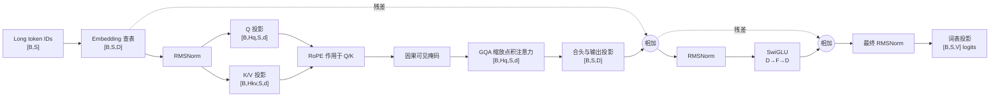

# T13 小型前向

**目标**：把词元编号（token IDs）一路送到词表分数（logits），把 B04 的模块放进同一个真实前向顺序；再用推测解码导读说明 target（目标模型）、draft（草稿模型）、验证与纠正各自负责什么。

## 前置基础

- **词元编号（token ID）**：分词器给离散词元的整数索引。本实验直接提供索引，不实现分词器。
- **嵌入（Embedding）**：用编号查询可训练表，把 `[B,S]` 变成 `[B,S,D]`。`B` 是 batch size（批大小），`S` 是 sequence length（序列长度），`D` 是 model width（模型宽度）。
- **隐藏状态（hidden states）**：模型层间传递的连续特征；这里每个词元用 D 个数表示。
- **注意力（Attention）**：用 Query（查询，Q）与 Key（键，K）的相似分数，对 Value（值，V）加权求和。缩放点积注意力（Scaled Dot-Product Attention，SDPA）先算 $QK^T/\sqrt{d}$，再沿键位置做 softmax。
- **因果掩码（causal mask）**：位置 i 只允许读取位置不大于 i 的键，禁止利用未来词元。
- **旋转位置嵌入（Rotary Position Embedding，RoPE）**：按绝对位置旋转 Q/K 的特征对，使注意力分数携带位置信息。
- **分组查询注意力（Grouped Query Attention，GQA）**：多个查询头共用较少的键值头。`Hq` 是查询头数，`Hkv` 是键值头数，`d=D/Hq` 是每头宽度。
- **均方根层归一化（Root Mean Square Layer Normalization，RMSNorm）**：按每个词元的最后特征轴归一化；不减均值，输出形状不变。
- **Swish 门控线性单元（Swish-Gated Linear Unit，SwiGLU）**：两条线性支路分别产生门和值，SiLU（Sigmoid Linear Unit，Sigmoid 线性单元）门控后投影回 D。
- **残差连接（residual connection）**：将子层更新加回子层输入，要求两侧 shape（形状）相同。
- **logits**：输出线性层对词表每个词元给出的未归一化分数，形状 `[B,S,V]`；`V` 是 vocabulary size（词表大小）。对最后一个位置做 softmax 才得到下一词元分布。本实验返回 logits，不采样。

程序使用小模型验证这些接口与 shape（形状）连接关系，不加载权重，不代表真实模型质量或生成行为。

## 数据流



图中两条残差线很重要：Attention（注意力）支路以块输入为旧值，SwiGLU（门控前馈网络）支路以注意力残差结果为旧值。两次相加都在 `[B,S,D]` 上完成。


### 形状记录

默认示例 `B=1,S=4,V=17,D=8,Hq=4,Hkv=2,d=2,F=12`，程序实际打印：

| 执行位置 | shape | 变化原因 |
| --- | --- | --- |
| 输入 token IDs | `[1,4]` | 四个离散整数索引 |
| Embedding 输出 | `[1,4,8]` | 每个索引查出 8 个特征 |
| Q | `[1,4,4,2]` | 8 个特征拆为 4 个查询头，每头 2 维 |
| K、V 各自 | `[1,2,4,2]` | 每个键值头由连续的两个查询头共享 |
| 注意力输出 | `[1,4,4,2]` | 每个查询头、每个位置取 2 维加权结果 |
| 合头、两次残差、最终 norm | `[1,4,8]` | 四个 2 维头拼回模型宽度 8；SwiGLU 内部暂扩到 `[1,4,12]` 后投回 8 |
| logits | `[1,4,17]` | 每个位置对 17 个词元各给一个分数 |

实际运行环境和 logits 数值见[验证报告](../../../../reports/stage-02/2026-10-14-t13-validation.md)及原始输出。

## 公式推导

### 单个块

令输入隐藏状态为 $X\in\mathbb{R}^{B\times S\times D}$。前置均方根层归一化（RMSNorm）先作用于注意力支路。查询投影把 D 个特征改成 $H_qd$ 个特征；因为 $H_qd=D$，拆成头后得到 `[B,Hq,S,d]`。键和值只投影成 `Hkv*d`，故为 `[B,Hkv,S,d]`。

注意力支路的执行顺序是：

$$
Q'=\operatorname{RoPE}(W_q\operatorname{RMSNorm}(X))
\quad\text{（定义：投影后的查询按位置旋转）}
$$

$$
K'=\operatorname{RoPE}(W_k\operatorname{RMSNorm}(X))
\quad\text{（定义：投影后的键按位置旋转）}
$$

$$
Z=\operatorname{GQA}(Q',K',W_v\operatorname{RMSNorm}(X),M)
\quad\text{（定义：掩码 M 下查询键值注意力）}
$$

$$
X_1=X+W_o\operatorname{merge}(Z)
\quad\text{（残差定义：块输入加回注意力更新）,其中 Wo 是输出投影矩阵,merge把多头注意力算出的多个头（heads）沿头维度拼回去，再恢复成原始序列表示形状。}
$$

`M` 是因果掩码（causal mask，未来位置为 False）；GQA（Grouped Query Attention，分组查询注意力）会把键值头按连续分组映射给查询头。程序沿用 T12 对应的小型显式 reference（参考实现），因此这里确实构造了掩码与重复后的 K/V，不能据此声称采用了融合算子或省掉了临时内存。

第二条前置归一化支路为：

$$
F=\operatorname{SwiGLU}(\operatorname{RMSNorm}(X_1))
\quad\text{（定义：归一化后计算门控前馈更新）}
$$

$$
X_2=X_1+F
\quad\text{（残差定义：注意力结果加回前馈更新）}
$$

SwiGLU（Swish-Gated Linear Unit，Swish 门控线性单元）将中间宽度从 D 扩到 F 再压回 D，所以第二次相加仍合法。最终词表头把最后一轴从 D 投影到 V：

$$
\operatorname{logits}=W_{lm}\operatorname{RMSNorm}(X_2)
\quad\text{（线性层定义：每个位置映射为 V 个未归一化分数）}
$$

## 推测解码（Speculative Decoding）

### 1. 解决了什么问题？（为什么需要它）

在传统的**自回归解码（Autoregressive Decoding）**中，大模型（目标模型，Target Model）必须**一个词一个词地串行生成**：每吐出一个词元（Token），都要把庞大的模型权重从显存重新搬运并完整运行一次。

这就带来了一个严重的硬件瓶颈：
- **串行生成极慢（受限于显存带宽）**：每次只生成 $1$ 个词，算力远远没跑满，绝大部分时间都浪费在“搬运庞大模型权重”的显存通信上。
- **并行输入其实很快（算力充沛）**：因为 GPU 极其擅长并行计算，让大模型一次性“同时检查 $5$ 个词”，和“只生成 $1$ 个词”所花的时间几乎一样。

**核心痛点**：既然大模型“一次处理多个词”和“一次处理一个词”耗时差不多，能不能不让它一个字一个字地憋，而是直接把一串词塞给它一次性并行处理？

---

### 2. 核心思想：怎么解决的？（“实习生写草稿，专家批量审阅”）

**推测解码（Speculative Decoding）**的解决思路非常直观——引入一个体积极小、运行飞快的 **Draft Model（草稿模型，相当于“实习生”）**，配合庞大的 **Target Model（目标模型，相当于“资深专家”）** 协同工作：

1. **实习生快速打草稿（串行但极快）**：先让轻量级的草稿模型一口气往后猜 $\gamma$ 个候选词（比如连猜 $4$ 个词）。虽然它也是一个个词串行猜的，但因为模型极小，耗时微乎其微。
2. **专家一次性批改（并行验证）**：把这 $\gamma$ 个草稿词拼在一起，一次性塞给庞大的目标模型。目标模型只需**运行一次前向传播**，就能同时算出这几个位置上“专家自己原本会怎么选”的概率。
3. **对得上就全盘接收，不对就当场重改**：从左往右逐词比对。只要实习生猜的词符合专家的标准，就直接通过；一旦遇到第一个不满意的词，专家当场亲自重写这一个词，并把后面关联的草稿全部作废。

> **关键保证（无损加速）**：通过严谨的“拒绝重采样”数学修正，推测解码最终生成的文本概率分布，与“完全让目标模型自己一个词一个词生成”**100% 严格一致**，绝不会因为引入了小模型而降低生成质量。（算法职责源自 R13 Algorithm 1 与 §2.1–2.3；本章仅作导读，不实现具体代码。）

---

### 3. 具体实现方式（四步流水线）

假设每轮让草稿模型往前猜 $\gamma$ 个词，完整的一轮推测解码分为以下四个阶段：

| 阶段                                     | 输入数据                                              | 核心职责与输出（具体干了什么）                               |
| :--------------------------------------- | :---------------------------------------------------- | :----------------------------------------------------------- |
| **① Draft 草拟**<br>*(小模型串行猜词)*   | 已确认的文本前缀                                      | 草稿模型按顺序往后猜出 $\gamma$ 个候选词 $x_1 \dots x_\gamma$，并记录它在猜每个词时的概率分布 $q_1 \dots q_\gamma$。<br>*(注：草稿模型内部依然是一个词接一个词串行生成的，只是因为它体积小所以快。)* |
| **② Target 验证**<br>*(大模型并行打分)*  | 已确认前缀 + 所有候选词 $x_1 \dots x_\gamma$          | 目标模型利用因果掩码（Causal Mask），**仅用一次前向传播**并行算出 $\gamma+1$ 个位置的真实概率分布 $p_1 \dots p_{\gamma+1}$。<br>*(其中每个 $p_i$ 代表：“假设前 $i-1$ 个草稿词都正确接上了，目标模型认为第 $i$ 个词应该是什么”。)* |
| **③ 接受判断**<br>*(逐词审核草稿)*       | 对齐后的分布 $p_i, q_i$ 与随机采样数                  | 从第 $1$ 个候选词开始往后逐个检验，以 $\min\left(1, \frac{p_i(x_i)}{q_i(x_i)}\right)$ 的概率决定是否接受候选词 $x_i$：<br>• 若目标模型比草稿模型更认可这个词（$p_i(x_i) \ge q_i(x_i)$），**100% 接受**；<br>• 若目标模型没那么认可（$p_i(x_i) < q_i(x_i)$），则按比例概率接受或拒绝。<br>• **一旦遇到第一个被拒绝的词，立刻停止审核**，它后面的所有草稿词直接丢弃（不能越过错误的前提继续往后看）。 |
| **④ 纠正或补词**<br>*(修正错误或领奖励)* | 首个被拒位置的分布，或最后一个额外分布 $p_{\gamma+1}$ | 分两种情况收尾：<br>• **中途有词被拒（假设第 $i$ 个词被拒）**：把草稿分布多出来的部分砍掉，从修正后的差值分布 $\text{normalize}(\max(p_i - q_i, 0))$ 中重新抽取一个正确的词替换掉 $x_i$，本轮结束（共产出 $i$ 个词）。<br>• **$\gamma$ 个候选词全部通过**：不仅这 $\gamma$ 个词全留用，由于第 ② 步目标模型顺便算出了第 $\gamma+1$ 个位置的分布 $p_{\gamma+1}$，直接从中白嫖抽取 $1$ 个 **Bonus Token（额外奖励词元）**，本轮共满额产出 $\gamma+1$ 个词！ |

---

### 4. 核心要点与阅读避坑总结

- **谁说了算？** **Target（目标模型）掌握最终决定权**，最终输出的分布完全由它决定；**Draft（草稿模型）只负责提供廉价提议**，没有最终决定权。
- **到底哪里并行了？** 只有**阶段 ②（目标模型验证打分）**是真正把多个位置塞进去并行前向计算的；而**阶段 ①（草稿模型生成候选词）**依然是串行的。
- **为什么一定能保底不亏？** 即使草稿模型猜的第 $1$ 个词就被拒绝了，阶段 ④ 也会当场根据已算出的 $p_1$ 纠正出 $1$ 个正确的词——这意味着跑一次目标模型**最少也能保底生成 $1$ 个词**，运气好则一次产出多达 $\gamma+1$ 个词。
- **实际能加速多少？** 真实的速度收益取决于三个因素：**草稿模型的猜词准确率（接受率）**、**草稿模型自身的运行开销**，以及**硬件的并行计算余量**。（注：T13 未对推测解码的实际加速比进行基准测试。）

## 符号说明

| 符号 | 含义 |
| --- | --- |
| `B` | batch size（批大小） |
| `S` | sequence length（序列长度） |
| `V` | vocabulary size（词表大小） |
| `D` | model width（模型宽度） |
| `F` | feed-forward width（前馈中间宽度） |
| `Hq` / `Hkv` | query heads（查询头数）/ key-value heads（键值头数） |
| `d` | head dimension（每头特征宽度），本例 `D/Hq` |
| `γ` | draft length（草稿长度），每轮草拟的候选词元数 |
| `p_i` / `q_i` | target（目标模型）/ draft（草稿模型）在第 i 个对齐位置的词元概率分布 |
| `M` | causal mask（因果掩码），决定每个查询可见哪些键 |

## 程序实例

仓库根目录运行：

```bash
.venv/bin/python learning/batches/b04-decoder-block/t13-small-decoder-forward/decoder.py
.venv/bin/python learning/batches/b04-decoder-block/t13-small-decoder-forward/test_t13.py
```

代码入口是 `TinyDecoderLM.forward`。它先验证 Long 类型 token IDs，再按真实顺序调用 T11 的嵌入查表、T13 小块、最终 RMSNorm（均方根层归一化）和 vocab projection（词表投影）；返回 `(logits, shape_trace)`。小块里的 Q/K/V 拆头、RoPE、显式因果掩码、GQA、合头、SwiGLU 和残差均按执行顺序分段。shape trace（形状轨迹）只存维度元组，不保留中间张量。

模型在程序入口使用 `torch.manual_seed(1313)`，固定词元编号 `[1,4,2,8]`，在 CPU float64 上运行。默认位置为 `0,1,2,3`。代码不包括分词器、训练、loss、采样、缓存、批量补齐、Dropout 或模型权重加载。`lm_head` 与 Embedding 不共享参数，便于把输入查表和输出投影的职责分开观察。

## 第一月复盘

统计边界：阶段 1 的第一月从 B01/T01 起算，记录日期为 2026-09-27 至 2026-10-14，日期相差 17 天（首尾共 18 个日历日）。每日记录目前有 7 个相关日期条目：9/27、10/8、10/9 与 10/11–10/14。记录没有逐任务开始/结束时刻，因此不能诚实地换算成有效学习小时；日期条目数也只是日志证据，不等于完整工时。

| 复盘项 | 可核实结果 | 对计划的调整 |
| --- | --- | --- |
| 任务进度 | T01–T13 已有完成记录或当前 T13 产物；覆盖 B01–B04，推进到原计划第 4 周内容 | 保持按依赖逐项推进，阶段周数不折算成有效工时 |
| 工作节奏 | 日志日期集中在 9/27 与 10/8–10/14，中间有未记录间隔；无法把日历跨度解释为连续学习速度 | 后续每次开始/结束时记录实际分钟数、任务编号和中断；复盘时按有效时间而非日期差修预算 |
| 后续预算 | B05 含 T14–T16 三个独立产物；T13 这次先作为一个集成任务建立首个可比样本 | B05 暂按每项 2–3 次有记录会话，即合计 6–9 次会话规划；每项结束后用真实时长替换估计，再决定是否压缩/扩展 B06。此为会话预算，不伪装成小时预算 |
| 风险顺序 | T14 先打通小 LM 与生成，T15 依赖其位置/前缀语义，T16 需用真实缓存状态对照估算 | 保持 T14→T15→T16 顺序；T15 若暴露 cache 对齐问题，优先给它增加时间，不挤掉正确性验证 |

从下一次 B05 会话开始补记“开始时间、结束时间、暂停分钟、净投入分钟”。这会让 B05 结束后的预算调整有实际工时数据，而不是从任务数量推算小时数。

## 直观理解

小 Decoder 像一条档案加工线：编号先查出特征卡，注意力读取当前位置以前的卡片，两个加工站各自把新信息加回旧卡，最后给词表中每个词打分。推测解码则让小助手先拟候选，大模型逐项核对；遇到首个不合适的候选就由大模型按修正后的分布接手。

## 资料

- R04：《Attention Is All You Need》§3 的编码器/解码器层结构；T13 采用 decoder-only（仅解码器）的小型组合，不复刻原论文完整编码器—解码器。
- R05：Hugging Face Transformers Llama 文档和 `modeling_llama.py`；沿用 pre-norm（前置归一化）、RoPE（旋转位置嵌入）、GQA（分组查询注意力）、RMSNorm（均方根层归一化）和 SwiGLU（Swish 门控线性单元）组件结构。实际运行版本以本仓库已冻结的 T12 来源记录为参照；T13 不导入 Transformers。
- R13：Leviathan 等人，*Fast Inference from Transformers via Speculative Decoding*，PMLR 202 (2023)，Algorithm 1、§2.1–2.3。论文描述草稿提出、目标模型并行验证、首拒绝纠正与全接受 bonus token；精确分布保持要求对齐同一采样变换。
- R19：《深入理解 AI Infra》2.1–2.3、3.1–3.2 的模型计算、上下文状态、生成依赖与请求负载相关小节，用于理解前向成本和自回归串行依赖；T13 没有复现书中的性能模型。
