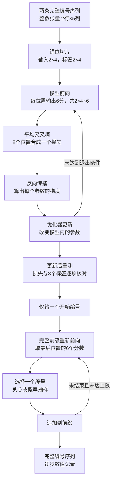

# T14 学习笔记

## 研究问题

T13 已经能把一串整数编号送进解码器（Decoder，读取已有上下文并产生特征的网络），输出每个位置的词表分数。但“能输出分数”还没有回答三个问题：**正确答案从哪里来？参数如何根据答案改变？没有答案时如何连续生成？** T14 研究的就是这三个环节怎样接成一个可检查的程序。

本章让模型记住两条人工序列：从一种开始标记出发，依次接 A、B、C、结束标记；从另一种开始标记出发，依次接 C、B、A、结束标记。训练时把完整序列拆成一对对“已有内容→正确下一项”；生成时只给开始标记，让模型把自己的预测接回输入，直到生成结束标记。

程序的解决路径是：**把续写转成每个位置的分类问题，用损失函数评价预测，用梯度修改参数，再用固定参数逐步选出新编号。** 本章会逐层说明这句话中每个动作操作的是什么数据，以及它在代码哪里发生。

| 需要回答的问题 | 程序采用的方法 | 可以核对的结果 |
| --- | --- | --- |
| 每个位置应该预测什么？ | 输入与标签从同一序列错开一格切出 | 两个 `[2,4]` 整数张量的具体内容 |
| 当前模型错了多少？ | 比较 8 排词表分数与 8 个正确编号，计算平均交叉熵 | 单个损失数值，以及逐位置预测 |
| 怎样让模型记住样本？ | 反向传播算参数梯度，优化器反复更新参数 | 最终损失低于 `0.01`，8 个位置全部预测正确 |
| 没有标签时怎样继续？ | 取末位置分数，选一个编号，追加到前缀再预测 | 每一步前缀、6 个分数、选中编号、结束条件 |

本实验只有 600 个可训练数值和两条人工序列。“过拟合”（Overfitting，记住训练样本而未证明对新样本有效）在这里是主动设定的目标：先用可以逐项核对的数据检验程序连接。实验不提供自然语言能力的证据。

## 阅读路线

建议按下表从上到下读。术语会在相关步骤重新注明含义；可以随时对照[训练源码](train_generate.py)与[检查源码](test_t14.py)的逐行注释。

| 顺序 | 阅读内容 | 读完能对上的代码 |
| --- | --- | --- |
| 1 | 数据基础：编号、张量、位置、输入、标签 | `fixed_sequences`、`shift_for_next_token` |
| 2 | 模型基础：查表、上下文、输出头 | `TinyDecoderLM(...)`、`model(inputs)` |
| 3 | 概率损失：分数怎样变成可优化的数值 | `F.cross_entropy(...)` |
| 4 | 梯度更新：损失怎样影响参数 | `zero_grad`、`backward`、`step` |
| 5 | 训练全程：一次调用的真实执行顺序 | `train_toy_model`、`main` |
| 6 | 生成全程：如何从一项长成完整序列 | `generate`、`choose_next_token` |
| 7 | 基础应用、源码导读、运行复核 | 把概念、语句与实际证据交叉核对 |

全局数据流如下。图中的“分数”还不是概率，“选择编号”也不会改变模型参数。



## 数据基础

### 编号与词表

词元（Token）是模型允许接收或输出的一个离散符号。真实模型可能把文字切成词元；本实验直接规定符号，没有实现分词器（Tokenizer，将文字转换为词元编号的程序）。

词表（Vocabulary）是所有候选符号的目录；词元编号（Token Identifier）是这个目录里的整数索引。编号是地址，不是大小、相似度或概率。编号 5 不意味着 C 比编号 3 的 A 更重要。

| 词元编号 | 人为约定的符号 | 作用 |
| ---: | --- | --- |
| 0 | `BOS_A` | Beginning of Sequence，第一条序列的开始标记 |
| 1 | `BOS_C` | Beginning of Sequence，第二条序列的开始标记 |
| 2 | `EOS` | End of Sequence，两条序列共用的结束标记 |
| 3 | A | 普通人工符号 |
| 4 | B | 普通人工符号 |
| 5 | C | 普通人工符号 |

因此词表大小 `VOCAB_SIZE=6`。这意味着模型每个位置必须给 6 个候选各打一分，标签则必须是 `0..5` 中的一个编号。

为什么有两个开始标记？如果两行都从同一个编号 0 开始，却要求一行下一项为 A、另一行下一项为 C，那么相同上下文会要求两个不同答案。概率模型可以把概率分给两个答案，但确定性最大值选择不能同时满足两个互相冲突的标签。因此要实现“8 个位置全部命中”的本实验目标，开始信息必须能区分两条路径。

[历史报告](../../../../reports/stage-02/2026-10-15-t14-validation.md)记录了相同起始编号导致训练不达标的失败。修正的是数据任务的可满足性，增加训练轮数不能消除这个矛盾。

### 张量与位置

张量（Tensor）是带数据类型、轴长度和存储位置的多维数组。这里先从 Python 数据容器理解它：

| 表达方式 | 内容层次 | 本程序中的用途 |
| --- | --- | --- |
| `3` | 一个整数，标量 | 某个词元编号 |
| `[0,3,4,5,2]` | 一维 Python 列表 | 一条完整序列 |
| `[[0,3,4,5,2],[1,5,4,3,2]]` | 两个列表组成的列表 | 两条完整序列 |
| `torch.tensor(..., dtype=torch.long)` | 把列表内容创建成整数张量 | 送入模型与损失函数的数据 |

张量形状（Shape）说明每一轴有多长。`[2,5]` 表示 2 行、每行 5 项，总共 10 个编号；它不是张量实际内容 `[2,5]`。批次（Batch）是一次共同处理的样本集合，本例大小为 2。序列（Sequence）是每行内部按顺序排列的词元，本例完整长度为 5。

本章用 $B$ 表示批次行数、$S$ 表示**完整序列**长度、$V$ 表示词表大小、$D$ 表示每个位置的特征宽度。它们在本例分别为 2、5、6、8。训练输入长度是 $S-1$，即 4；生成前缀长度会变，另用 $P$ 表示。

“位置”和“编号”必须区分。例如首行 `[0,3,4,5,2]` 的位置 1 存着编号 3。位置回答“第几项”，编号回答“哪一个符号”；`logits[0,1,3]` 则是第 0 行、输入位置 1、候选编号 3 的分数。

数据类型（Data Type）也有分工：

- `torch.long` 是 64 位整数。本例输入是查表地址，标签是正确类别索引，两者都使用它；不对编号本身求梯度。
- `float32` 是 32 位浮点数。本例模型参数、内部特征、输出分数和损失使用它，允许连续变化。
- CPU（Central Processing Unit，中央处理器）是本实验的运行设备。安装包虽然带 CUDA 支持，这里没有把模型移到 GPU（Graphics Processing Unit，图形处理器）。

### 输入与标签

监督学习（Supervised Learning）需要给出“输入”和“正确答案”。本实验无需人工为每个位置再标一次：完整序列的后一个编号，就能作为当前位置预测的答案。

先写一般对齐方式。这里 $x_t$ 是完整序列位置 $t$ 的真实词元编号：

$$
\begin{aligned}
\mathrm{inputs}
&\overset{\text{去掉最后一项}}{=}
[x_0,x_1,x_2,x_3] \\
\mathrm{targets}
&\overset{\text{去掉第一项}}{=}
[x_1,x_2,x_3,x_4]
\end{aligned}
$$

再代入两条实际序列：

| 数据 | 第 0 行 | 第 1 行 | 张量形状 |
| --- | --- | --- | --- |
| 完整序列 `sequences` | `[0,3,4,5,2]` | `[1,5,4,3,2]` | `[2,5]` |
| 输入 `inputs` | `[0,3,4,5]` | `[1,5,4,3]` | `[2,4]` |
| 标签 `targets` | `[3,4,5,2]` | `[5,4,3,2]` | `[2,4]` |

代码 `sequences[:, :-1]` 中，第一个冒号取所有行，`:-1` 从开头取到最后一列之前；`sequences[:, 1:]` 则从第二列取到结尾。两边保持相同的行与位置排列，只让“答案来源”向后错一格。

“标签右移”在本章指**标签取自原序列中右边的下一位置**，实际代码没有移动张量里的元素，也没有另做一次符号置换。其他库可能内部完成错位；本程序的 `cross_entropy` 不负责错位，所以这里由 `shift_for_next_token` 显式完成，不能重复错开。

把 8 个预测任务全部展开，便能看清“已有内容”到底是什么：

| 样本行 | 输入位置 | 因果规则允许看到的内容 | 此位置正确标签 |
| ---: | ---: | --- | ---: |
| 0 | 0 | `[0]` | 3 |
| 0 | 1 | `[0,3]` | 4 |
| 0 | 2 | `[0,3,4]` | 5 |
| 0 | 3 | `[0,3,4,5]` | 2 |
| 1 | 0 | `[1]` | 5 |
| 1 | 1 | `[1,5]` | 4 |
| 1 | 2 | `[1,5,4]` | 3 |
| 1 | 3 | `[1,5,4,3]` | 2 |

模型的输入参数只接收 `inputs`；`targets` 交给后面的损失函数，不作为额外模型输入。完整训练输入虽然含有后续真实编号，模型内部仍须保证早期位置不能读取它们，这就是下一节的因果屏蔽。

如果输入和标签不做错位，模型会被要求复述已经读到的当前编号；如果漏掉结束编号作为标签，就没有这个明确的“到这里应结束”的监督信号。

### 存储与视图

`sequences[:, :-1]` 和 `sequences[:, 1:]` 是视图（View，共享底层存储的不同观察方式），不是各自复制一份数据。共享意味着对视图就地写入可能影响原序列；本程序只读这些数据。

原张量每行跨 5 个元素；去掉一列后，视图每行只显示 4 项，跨到下一行时仍要跨原先的 5 项。因此这两个 `[2,4]` 视图通常不连续（Non-contiguous，逻辑相邻元素不全按紧密顺序存放）。`targets.reshape(-1)` 必须在逻辑顺序正确的前提下展平；需要时会复制，不能认定展平总是零拷贝。若直接改成要求存储兼容的 `.view(-1)`，这种切片布局就可能报错。

模型和张量是 Python 对象。函数返回视图后，视图的引用会使相关底层存储继续有效；不需要担心创建它的局部变量退出就立即让它悬空。

## 模型基础

### 可训练函数

模型可以看成带参数的函数 $f_\theta$。$\theta$ 代表全部可训练参数（Parameter，训练会调整的数值），不是一个词元编号。输入数据固定时，参数不同，分数就可能不同。

$$
\begin{aligned}
z
&\overset{\text{使用当前参数前向计算}}{=}
f_\theta(\mathrm{inputs})
\end{aligned}
$$

这里 $z$ 表示输出的未归一化分数。代码里对应 `logits, _shape_trace = model(inputs)`；第二个返回值是形状轨迹字典（Shape Trace，只记录各阶段形状）。模型调用并不自动比较答案，也不自动修改参数。

先分清四类状态，后续就不会把“训练”和“生成”混在一起：

| 对象 | 谁创建 | 谁改变 | 生命周期 |
| --- | --- | --- | --- |
| 输入与标签 | 固定数据函数、切片函数 | 本程序保持只读 | 训练后仍随返回值可用 |
| 模型参数 | `TinyDecoderLM(...)` | `optimizer.step()` | 训练结束后留在模型对象里 |
| 梯度与优化器历史 | 反向传播、优化器 | 每轮计算和更新 | 梯度留在参数字段；优化器不随结果返回 |
| 生成前缀与轨迹 | `generate(...)` | 选词后追加、记录 | 作为 Python 列表返回给调用者 |

### 从编号到分数

词元嵌入（Token Embedding）是可训练的查表操作。词嵌入表有 6 行、每行 8 个浮点特征；输入编号 3 就读取第 3 行向量。编号不用乘以某个“语义系数”，也不是把整数 3 当成连续特征。

例如，若仅为说明查表而把向量宽度暂设为 2，嵌入表第 3 行是 `[0.2,-0.5]`，第 4 行是 `[0.7,0.1]`，那么 `[3,4]` 就查成 `[[0.2,-0.5],[0.7,0.1]]`。这是教学示例，实际实验宽度是 8，数值由随机初始化和训练决定。

接着，解码器块（Decoder Block）让各位置的特征读取允许范围内的上下文，再做特征变换。最后，语言模型输出头（Language Model Head）把每位置的 8 个特征投影成 6 个候选分数。

这个输出头就是无偏置线性层。设 $h_d$ 是某位置第 $d$ 个特征，$W_{v,d}$ 是输出头给候选 $v$ 使用的第 $d$ 个权重，则：

$$
\begin{aligned}
z_v
&\overset{\text{对特征做加权求和}}{=}
\sum_{d=0}^{D-1}W_{v,d}h_d
\end{aligned}
$$

先把上式缩成两特征的小例子：候选 $v$ 对应权重 `[1,2]`，特征是 `[0.2,-0.5]`，则：

$$
\begin{aligned}
z_v
&\overset{\text{代入权重与特征}}{=}
1\times0.2+2\times(-0.5) \\
&\overset{\text{先乘再相加}}{=}-0.8
\end{aligned}
$$

这说明为什么输出能是负数：它是线性打分，不是概率。训练可以改变权重和上游特征，使正确候选相对其他候选得到更高分。

### 上下文怎样进入

因果注意力（Causal Attention）让位置 $t$ 只能读取自己及更早位置的信息。用 1 表示可读、0 表示禁止，长度为 4 时的读取规则是：

| 当前输出位置 | 读输入 0 | 读输入 1 | 读输入 2 | 读输入 3 |
| ---: | ---: | ---: | ---: | ---: |
| 0 | 1 | 0 | 0 | 0 |
| 1 | 1 | 1 | 0 | 0 |
| 2 | 1 | 1 | 1 | 0 |
| 3 | 1 | 1 | 1 | 1 |

注意力的查询（Query）表示当前位置要寻找什么信息，键（Key）参与判断其他位置与查询有多匹配，值（Value）是按匹配权重汇合的信息。禁止未来位置的屏蔽规则（Mask）作用于匹配关系，确保即使训练时整条输入都在内存里，也不能从右边偷看正确下一项。

同一完整输入中的四个位置可以一次共同前向，各自仍遵守不同的可见范围。使用真实历史词元作为训练上下文的方式称为教师强制（Teacher Forcing）。生成时还没有真实后续词元，必须把模型刚选出的编号作为新历史；这使生成按步骤推进。

本例的输出头在不同位置共享同一组权重，但不同位置的上下文特征不同。两行的中间位置都出现 B，并不意味着之后必须相同：一个上下文是 `[0,3,4]`，另一个是 `[1,5,4]`，模型可依据不同历史预测 C 或 A。

### 内部各层

下面按 T13 代码真实前向顺序列出每层的职责。这里给出读懂本章所需的解释，组件独立公式与实验可再查 [T11](../../b04-decoder-block/t11-embedding-residual-rmsnorm-swiglu/README.md)、[T12](../../b04-decoder-block/t12-rope-gqa-position/README.md) 和 [T13](../../b04-decoder-block/t13-small-decoder-forward/README.md)。

| 执行阶段 | 本例形状 | 为什么需要它 |
| --- | --- | --- |
| 词元嵌入（Token Embedding） | `[2,4] → [2,4,8]` | 整数目录地址转成可训练的浮点特征 |
| 均方根层归一化（Root Mean Square Layer Normalization，RMSNorm） | `[2,4,8] → [2,4,8]` | 按每位置的 8 个特征计算均方根尺度，再缩放特征；不改变位置数 |
| 查询/键/值投影（Query/Key/Value Projection） | 查询 `[2,4,4,2]`；键和值各 `[2,2,4,2]` | 把特征分成查询、匹配信息和待汇合信息，每头宽度 2 |
| 旋转位置嵌入（Rotary Position Embedding，RoPE） | 查询与键形状不变 | 用位置相关旋转改变查询与键的匹配关系，使模型能使用先后位置 |
| 分组查询因果注意力（Grouped Query Attention，GQA） | `[2,4,4,2]` | 4 个查询头分组共享 2 个键值头，并按因果规则汇合历史信息 |
| 合并头、输出投影、残差相加（Residual Connection） | `[2,4,8]` | 合并各头特征；将注意力更新量加回进入子层前的特征 |
| 均方根层归一化（Root Mean Square Layer Normalization） | `[2,4,8]` | 调整下一个子层输入的特征尺度 |
| Swish 门控线性单元（Swish-Gated Linear Unit，SwiGLU） | 内部两路各 `[2,4,12]`，再回 `[2,4,8]` | 一路特征经非线性函数形成门控，与另一路逐元素相乘，再投影回 8 维 |
| 第二次残差相加（Residual Connection） | `[2,4,8]` | 把前馈更新量加回上一状态，保持统一的特征宽度 |
| 最终均方根层归一化（Root Mean Square Layer Normalization） | `[2,4,8]` | 调整词表输出头接收的特征尺度 |
| 语言模型输出头（Language Model Head） | `[2,4,8] → [2,4,6]` | 每个位置给词表中全部 6 个候选打分 |

注意普通特征轴顺序为 `[样本,位置,特征]`，多头内部则是 `[样本,头,位置,每头特征]`。查询的 `[2,4,4,2]` 中两个 4 分别是查询头数与位置数，恰好相等，不是同一概念。

残差相加的意思是“旧特征 + 子层算出的更新量”，因此两者形状必须一致。均方根层归一化对每个位置的特征轴缩放，不会像批次归一化（Batch Normalization）那样维护本实验中的批次运行统计。位置模块与屏蔽规则不需要标签；它们在训练和生成中都参与模型前向。

模型总计 600 个可训练数值：词嵌入 48；注意力前归一化 8；查询/键/值投影 64/32/32；注意力输出投影 64；前馈前归一化 8；门控前馈三矩阵 288；最终归一化 8；词表输出头 48。两端的词嵌入表与输出头不共享权重。训练时 `model.parameters()` 遍历这些参数，优化器更新整个模型。

“全部参数交给优化器”不意味着每个数值每轮都必然改变。例如输入不含结束编号 2，它在嵌入表中的那一行没有被查到；候选 2 在输出头中的权重却会通过结束标签参与学习。标签里出现某编号，与输入嵌入表对应行被读取，是两个不同的行为。

## 概率损失

### 条件概率

模型为每个位置给一排未归一化分数（Logit Scores，代码名 `logits`）。例如 `logits[0,0]` 是看到首行前缀 `[0]` 时，对下一个编号为 `0,1,2,3,4,5` 的六个分数。

“下一个编号为 3 的概率”必须带上下文：给定 `[0]` 时，与给定 `[1,5]` 时是两个不同问题。记号 $p_\theta(v\mid c)$ 表示“在参数 $\theta$、已有上下文 $c$ 下，下一个编号是 $v$ 的概率”；竖线 $\mid$ 的意思是“给定”，不是除法。

本程序通过归一化指数函数（Softmax）把分数变成非负且总和为 1 的概率。先写一般公式，再代入示例：

$$
\begin{aligned}
p_v
&\overset{\text{指数为正并按总和归一化}}{=}
\frac{\exp(z_v)}{\sum_{j=0}^{V-1}\exp(z_j)}
\end{aligned}
$$

其中 $z_v$ 是候选 $v$ 的原始分数，$j$ 遍历所有词表候选，$V$ 是候选总数，$\exp(a)$ 是自然常数 $e$ 的 $a$ 次方。分母对所有候选相同，因此分数越大的候选概率也越大；贪心选择最大分数无需先求概率。

取一个独立教学向量 `[0,0,0,2,0,0]`，正确编号设为 3。它不是实际训练输出，优点是可以手算：

$$
\begin{aligned}
p_3
&\overset{\text{代入候选3的分数2}}{=}
\frac{e^2}{e^2+5e^0} \\
&\overset{e^0=1,\ e^2\approx7.389}{\approx}
\frac{7.389}{12.389} \\
&\overset{\text{执行除法}}{\approx}0.596418
\end{aligned}
$$

其余 5 个候选的分数都是 0，因此每个概率约为 `0.080716`。六项加起来约为 1。一个分数 2 不意味着概率为 2，也不意味着概率接近 1；它要与其余全部分数一起归一化。

### 为何用负对数

损失（Loss）要把“当前模型给正确答案的支持程度”变成一个可用于优化的标量。正确答案概率越高，应当损失越小；概率很低时，应当受到较大的惩罚。

本实验使用交叉熵损失（Cross-Entropy Loss）。设正确编号为 $y$，真实类别分布 $q_v$ 只在 $v=y$ 处为 1、其余为 0。这种形式叫独热标签（One-hot Label）；程序只保存编号 $y$，并未显式创建这个向量。

$$
\begin{aligned}
\ell
&\overset{\text{类别分布的交叉熵定义}}{=}
-\sum_{v=0}^{V-1}q_v\log p_v \\
&\overset{\text{只有正确类别的权重为1}}{=}
-\log p_y
\end{aligned}
$$

$\ell$ 是一个位置的损失，$\log$ 在这里是自然对数：它回答“自然常数 e 的多少次方等于这个正数”。因此概率小于 1 时对数为负，再取负号就得到正损失；概率等于 1 时对数为 0。上节正确编号 3 的概率为 `0.596418`，代入得到：

$$
\begin{aligned}
\ell
&\overset{\text{代入正确类别概率}}{\approx}
-\log(0.596418) \\
&\overset{\text{计算自然对数再取负号}}{\approx}
0.516814
\end{aligned}
$$

正确概率为 `0.9` 时损失约 `0.105361`；为 `0.1` 时损失约 `2.302585`。概率趋近于 1 时损失趋近于 0，趋近于 0 时损失不断增大。这里不只关心“最大分数是不是正确编号”，还关心正确编号得到多少概率。

再从完整序列理解训练目标。每一步都要在真实历史下预测正确下一项；整条序列在指定开始标记下的概率，可按概率链式规则写成：

$$
\begin{aligned}
&p_\theta(x_1,x_2,x_3,x_4\mid x_0) \\
&\overset{\text{依次条件化的概率链式规则}}{=}
\prod_{t=0}^{3}p_\theta(x_{t+1}\mid x_0,\ldots,x_t)
\end{aligned}
$$

$\prod$ 表示连乘，$x_t$ 是第 $t$ 个真实词元编号。取负对数后，乘积变成单位置负对数之和：

$$
\begin{aligned}
&-\log\prod_{t=0}^{3}
 p_\theta(x_{t+1}\mid x_0,\ldots,x_t) \\
&\overset{\text{乘积的对数等于对数之和}}{=}
\sum_{t=0}^{3}-\log
 p_\theta(x_{t+1}\mid x_0,\ldots,x_t)
\end{aligned}
$$

所以提高已知训练序列的概率，可以转成降低这些位置的损失之和。这是下一词元预测（Next-Token Prediction）与分类交叉熵连接的原因。

### 本例如何平均

本例有 2 行，每行 4 个预测位置，共 8 个分类问题。设 $B$ 是样本行数、$S$ 是完整序列长度，$b$ 遍历样本、$t$ 遍历输入位置：

$$
\begin{aligned}
N
&\overset{\text{行数乘有效位置数}}{=}
B(S-1) \\
&\overset{\text{代入本例}}{=}2\times4 \\
&\overset{\text{计数}}{=}8
\end{aligned}
$$

平均下一词元损失（Next-Token Cross-Entropy Loss）是：

$$
\begin{aligned}
\mathcal L
&\overset{\text{8个位置损失的平均}}{=}
\frac1N\sum_{b=0}^{B-1}\sum_{t=0}^{S-2}\ell_{b,t} \\
\ell_{b,t}
&\overset{\text{当前位置标签取原序列下一项}}{=}
-\log p_\theta(x_{b,t+1}\mid x_{b,0},\ldots,x_{b,t})
\end{aligned}
$$

#### 1. 有效预测位置总数 $N$

对于单条长度为 $S$ 的完整序列 $(x_{b,0}, x_{b,1}, \ldots, x_{b,S-1})$，模型采用错位预测（Shifted Prediction）：用位置 $t$ 的输出预测位置 $t+1$ 的真实词元。

由于序列末尾词元 $x_{b,S-1}$ 之后没有已知标签可供监督，最后一个位置不参与损失计算。因此单行有效输入位置下标为 $t \in \{0, 1, \ldots, S-2\}$。

$$\begin{aligned} N_{\text{单行}} &\overset{\text{区间整数计数公式}}{=} (S-2) - 0 + 1 \\ &\overset{\text{合并常数项}}{=} S - 1 \end{aligned}$$

共有 $B$ 个独立样本行，且每行有效预测位置数均为 $S-1$。当本例取 $B=2, S=5$ 时：

$$\begin{aligned} N &\overset{\text{对B行累加}}{=} \sum_{b=0}^{B-1} N_{\text{单行}} \\ &\overset{\text{代入单行位置数}}{=} \sum_{b=0}^{B-1} (S - 1) \\ &\overset{\text{常数求和展开}}{=} B(S - 1) \\ &\overset{\text{代入 } B=2, S=5}{=} 2 \times (5 - 1) \\ &\overset{\text{括号内相减}}{=} 2 \times 4 \\ &\overset{\text{相乘计数}}{=} 8 \end{aligned}$$

#### 2. 单步交叉熵损失 $\ell_{b,t}$

在第 $b$ 行、第 $t$ 个预测位置上，给定上文 $x_{b, \le t} = (x_{b,0}, \ldots, x_{b,t})$，模型输出词表上的预测概率分布 $p_\theta(v \mid x_{b, \le t})$。真实目标词元为下一项 $x_{b, t+1}$，其真实分布用克罗内克函数表示为 $q_{b,t}(v) = \delta_{v, x_{b,t+1}}$：

$$\begin{aligned} \ell_{b,t} &\overset{\text{多分类交叉熵定义}}{=} -\sum_{v=0}^{V-1} q_{b,t}(v) \log p_\theta(v \mid x_{b, \le t}) \\ &\overset{\text{代入独热分布}}{=} -\sum_{v=0}^{V-1} \delta_{v, x_{b,t+1}} \log p_\theta(v \mid x_{b, \le t}) \\ &\overset{\text{筛除v≠目标的零项}}{=} -1 \cdot \log p_\theta(x_{b,t+1} \mid x_{b, \le t}) \\ &\overset{\text{展开条件序列}}{=} -\log p_\theta(x_{b,t+1} \mid x_{b,0}, \ldots, x_{b,t}) \end{aligned}$$

若将模型在该位置输出的未归一化得分（Logits）记为向量 $z_{b,t} \in \mathbb{R}^V$，代入 Softmax 归一化定义可进一步展开到底层算子形式：

$$\begin{aligned} \ell_{b,t} &\overset{\text{代入Softmax公式}}{=} -\log \frac{\exp(z_{b,t}[x_{b,t+1}])}{\sum_{v=0}^{V-1} \exp(z_{b,t}[v])} \\ &\overset{\text{对数商法则展开}}{=} -z_{b,t}[x_{b,t+1}] + \log \sum_{v=0}^{V-1} \exp(z_{b,t}[v]) \end{aligned}$$

#### 3. 批次平均损失 $\mathcal{L}$

假设批次内 $B$ 条样本相互独立，整个批次生成的条件联合似然概率 $\mathcal{P}$ 为各样本、各时间步条件概率的连乘积：

$$\begin{aligned} \mathcal{P} &\overset{\text{样本独立同分布}}{=} \prod_{b=0}^{B-1} P_\theta(x_{b,1}, \ldots, x_{b,S-1} \mid x_{b,0}) \\ &\overset{\text{条件概率链式法则}}{=} \prod_{b=0}^{B-1} \prod_{t=0}^{S-2} p_\theta(x_{b,t+1} \mid x_{b,0}, \ldots, x_{b,t}) \end{aligned}$$

对联合似然取负对数，得到总负对数似然损失 $\mathcal{L}_{\text{sum}}$：

$$\begin{aligned} \mathcal{L}_{\text{sum}} &\overset{\text{负对数似然定义}}{=} -\log \mathcal{P} \\ &\overset{\text{代入联合似然}}{=} -\log \prod_{b=0}^{B-1} \prod_{t=0}^{S-2} p_\theta(x_{b,t+1} \mid x_{b,0}, \ldots, x_{b,t}) \\ &\overset{\text{对数乘积转求和}}{=} -\sum_{b=0}^{B-1} \sum_{t=0}^{S-2} \log p_\theta(x_{b,t+1} \mid x_{b,0}, \ldots, x_{b,t}) \\ &\overset{\text{负号移入求和号}}{=} \sum_{b=0}^{B-1} \sum_{t=0}^{S-2} \left( -\log p_\theta(x_{b,t+1} \mid x_{b,0}, \ldots, x_{b,t}) \right) \\ &\overset{\text{代入单步损失定义}}{=} \sum_{b=0}^{B-1} \sum_{t=0}^{S-2} \ell_{b,t} \end{aligned}$$

为消除批次大小 $B$ 和序列长度 $S$ 变化对梯度尺度的影响，对全部 $N$ 个分类任务求算术平均：

$$\begin{aligned} \mathcal{L} &\overset{\text{除以总有效预测数}}{=} \frac{1}{N} \mathcal{L}_{\text{sum}} \\ &\overset{\text{代入总损失展开式}}{=} \frac{1}{N} \sum_{b=0}^{B-1} \sum_{t=0}^{S-2} \ell_{b,t} \end{aligned}$$

#### 符号说明

- $B, S, V$：分别为批次样本行数（Batch Size）、完整序列长度（Sequence Length）、词表大小（Vocabulary Size）。
- $b, t, v$：分别为样本行索引（$0 \le b \le B-1$）、输入时间步索引（$0 \le t \le S-2$）、词表词元索引（$0 \le v \le V-1$）。
- $N$：当前批次内参与计算的独立分类任务（有效预测位置）总数。
- $x_{b,t}$：第 $b$ 行样本在第 $t$ 个位置的真实词元 ID；$x_{b, \le t}$ 表示从位置 $0$ 到 $t$ 的历史词元序列。
- $\theta$：神经网络模型的可学习参数集合。
- $p_\theta(\cdot \mid \cdot)$：由参数 $\theta$ 决定的条件概率分布函数。
- $\delta_{v, x_{b,t+1}}$：克罗内克函数（Kronecker delta），当词表索引 $v$ 等于真实下一词元 $x_{b,t+1}$ 时取 $1$，否则取 $0$。
- $z_{b,t}[v]$：模型在第 $b$ 行第 $t$ 步输出的 Logits 向量中第 $v$ 个词元的未归一化分值。
- $\ell_{b,t}, \mathcal{L}$：分别为单位置交叉熵损失标量、批次平均交叉熵损失标量。
- $\sum, \prod, \log$：分别为连加求和算子、连乘求积算子、自然对数算子（以 $e$ 为底）

`F.cross_entropy` 接收**原始分数与正确编号**；类别索引用法在数学上等价于 LogSoftmax（Logarithmic Softmax，对数归一化指数函数）接 NLLLoss（Negative Log-Likelihood Loss，负对数似然损失）。库用数值稳定的计算，不要求先显式构造概率张量。相关输入约定见 [PyTorch 交叉熵文档](https://docs.pytorch.org/docs/2.11/generated/torch.nn.CrossEntropyLoss.html)。

训练路径不能先手动 `softmax` 再交给 `cross_entropy`，否则库会把已归一化概率再次当成原始分数，计算的就不是上面的目标。生成抽样才需要显式概率，这两处输入目的不同。

### 为何需要展平

模型输出 `[2,4,6]`：每个样本、每个位置各有 6 个候选分数。损失函数的二维类别索引用法需要 `[分类问题个数,类别数]` 和 `[正确编号个数]`，因此代码使用：

```python
# reshape 的 -1 让 PyTorch 根据总元素数推算该轴大小。
# 2×4×6 个数重排为 8×6；每个位置的6个候选仍在同一行。
flat_logits = logits.reshape(-1, VOCAB_SIZE)
# 标签也必须按相同顺序展平；8个整数分别对应上面的8行。
flat_targets = targets.reshape(-1)
# 默认按8个位置求平均，得到零维张量，即一个损失数值。
loss = F.cross_entropy(flat_logits, flat_targets)
```

这是原程序复合表达式的拆开写法，便于观察中间量；实际源码没有额外引入这两个变量。

| 展平后的行号 | 原样本行 | 原输入位置 | 对应标签 |
| ---: | ---: | ---: | ---: |
| 0 | 0 | 0 | 3 |
| 1 | 0 | 1 | 4 |
| 2 | 0 | 2 | 5 |
| 3 | 0 | 3 | 2 |
| 4 | 1 | 0 | 5 |
| 5 | 1 | 1 | 4 |
| 6 | 1 | 2 | 3 |
| 7 | 1 | 3 | 2 |

不能直接把 `[2,4,6]` 交给这个默认接口并认为库总把最后轴当类别轴：多维类别索引接口把第二轴作为类别轴。显式变为 `[8,6]`，既消除了这个歧义，也让每行分数与一个标签直接对齐。

## 梯度更新

### 梯度是什么

梯度（Gradient）描述在当前位置微调参数，损失会怎样变化。对单个参数，正梯度表示把参数稍微增大时损失局部趋向增大，负梯度表示局部趋向减小。它是当前点附近的变化率，不保证一次大幅更新后的真实损失必然下降。

自动微分（Automatic Differentiation）会记录由参数到损失的运算关系，形成计算图（Computational Graph）；反向传播（Backpropagation）再从损失沿图应用链式法则，把变化率传回每个参数。PyTorch 的 `loss.backward()` 完成这一步，不是它来直接修改参数。[自动微分说明](https://docs.pytorch.org/tutorials/beginner/basics/autogradqs_tutorial.html)

下面只用到四条求导规则。导数是“输入很小的改变量，导致输出改变量的比例极限”；`d/dz` 表示对 z 求导，参数之外的固定数在这里视为常数。

| 规则 | 为什么在本章出现 | 此处怎样使用 |
| --- | --- | --- |
| 常数对变量的导数为 0；变量自身对自己的导数为 1 | 负对数展开后有 `-z_y` | 对正确类别的分数求导得到 -1，对其他分数求导得到 0 |
| 指数函数的导数仍为该指数函数 | 归一化分母是各候选指数之和 | 对候选 k 的分数求导，只留下它自己的指数项 |
| 自然对数在正数 u 处的导数为 `1/u` | 损失里有 `log Z` | 对 Z 的变化率先乘 `1/Z` |
| 复合函数的变化率沿依赖路径相乘，多条路径的贡献相加 | Z 又依赖每个分数，分数又依赖参数 | 把“损失对 Z”“Z 对分数”“分数对参数”的影响接起来 |

例如 z 增加约 0.001 时，若某函数在该点的导数为 2，它的输出局部约增加 0.002；步长变大后不能直接套这个局部近似。链式法则（Chain Rule）正是把这种局部变化率逐层连接。

先看最靠近输出的分数梯度。设 $z_k$ 是候选 $k$ 的分数、$y$ 是正确编号，$Z$ 是所有指数分数的总和：

$$
\begin{aligned}
Z
&\overset{\text{归一化分母的定义}}{=}
\sum_j e^{z_j} \\
\ell
&\overset{\text{将归一化概率代入负对数}}{=}
-\log\frac{e^{z_y}}{Z} \\
&\overset{\text{对数的商法则与}\log e^a=a}{=}
-z_y+\log Z
\end{aligned}
$$

对候选 $k$ 的分数求导。记 $\mathbf1_{k=y}$ 为指示量：编号相同取 1，不同取 0。分子 $e^{z_k}$ 来自对指数函数求导，除以 $Z$ 来自对数函数求导：

$$
\begin{aligned}
\frac{\partial\ell}{\partial z_k}
&\overset{\text{分别对两项求导}}{=}
-\mathbf1_{k=y}+\frac{e^{z_k}}{Z} \\
&\overset{\text{分式正是候选概率}}{=}
p_k-\mathbf1_{k=y}
\end{aligned}
$$

$\partial$ 表示只改变选定变量、暂时固定其余变量的偏导数。代入上节教学向量，正确编号 3 的分数梯度约 `0.596418-1=-0.403582`，其他每个编号约 `0.080716-0=0.080716`。若直接对这排分数做小步梯度下降，会提高正确分数、降低其他分数。平均 8 个位置时，每位置传回的相应梯度还会除以 8。

实际程序更新的是共享模型参数，不是给每条样本单独存一份可调分数。因此不能保证一次参数更新后，每条样本每个候选分数都各自按上面的符号单调变化。

### 怎样传到参数

链式法则（Chain Rule）把“损失对分数的变化率”与“分数对权重的变化率”相乘。上一节输出头的线性公式中，$W_{k,d}$ 表示候选 $k$ 的第 $d$ 个权重，$h_d$ 是该位置的特征，则对**单个位置**有：

$$
\begin{aligned}
\frac{\partial\ell}{\partial W_{k,d}}
&\overset{\text{链式法则}}{=}
\frac{\partial\ell}{\partial z_k}
\frac{\partial z_k}{\partial W_{k,d}} \\
&\overset{\text{线性加权和对权重求导}}{=}
(p_k-\mathbf1_{k=y})h_d
\end{aligned}
$$

整个批次共享这个权重，所以来自 8 个位置的贡献会汇合并按平均损失缩放。同样的反向规则还能穿过输出头、归一化、前馈与注意力，传回更早参数；嵌入表里被查到的浮点行也会获得梯度。整数编号只是选行地址，不因此变成可连续调整的参数。

这些导数由框架沿真实运算图计算；T14 不手写解码器各层的反向函数。参数的 `.grad` 字段保存本轮汇总梯度，参数本身仍保留更新前的值，直到优化器执行更新。

### 更新为何分开

优化器（Optimizer）把梯度变成参数更新。先用最简单的梯度下降（Gradient Descent）理解方向，设 $\eta$ 是正学习率、$g$ 是当前参数梯度：

$$
\begin{aligned}
\theta_{\mathrm{new}}
&\overset{\text{沿负梯度方向走一步}}{=}
\theta_{\mathrm{old}}-\eta g
\end{aligned}
$$

这只是说明方向的基础规则。本程序实际使用 AdamW（Adaptive Moment Estimation with Decoupled Weight Decay，解耦权重衰减的自适应矩估计），它还使用历史梯度的一阶矩和二阶矩来调整更新。

为了读懂 `optimizer.step()`，按**一个参数分量**写出本例无权重衰减时的更新。$n$ 表示更新次数，$g_n$ 是本轮梯度，$m_n$ 是梯度的指数移动平均，$r_n$ 是梯度平方的指数移动平均，开始时两者为 0：

$$
\begin{aligned}
m_n
&\overset{\text{一阶矩递推}}{=}
\beta_1m_{n-1}+(1-\beta_1)g_n \\
r_n
&\overset{\text{二阶矩递推}}{=}
\beta_2r_{n-1}+(1-\beta_2)g_n^2
\end{aligned}
$$

$\beta_1$ 和 $\beta_2$ 是保留历史信息的系数，本例采用库默认值 `0.9` 与 `0.999`。初值为 0 会使最早几步的移动平均偏小，因此还做偏差修正：

$$
\begin{aligned}
\widehat m_n
&\overset{\text{修正零初始化偏差}}{=}
\frac{m_n}{1-\beta_1^n} \\
\widehat r_n
&\overset{\text{同样修正二阶矩}}{=}
\frac{r_n}{1-\beta_2^n}
\end{aligned}
$$

最后使用修正后的历史量更新参数：

$$
\begin{aligned}
\theta_n
&\overset{\text{本例权重衰减为0的更新}}{=}
\theta_{n-1}
-\eta\frac{\widehat m_n}{\sqrt{\widehat r_n}+\varepsilon}
\end{aligned}
$$

本例学习率 $\eta$ 为 `0.02`，$\varepsilon$ 采用默认 `1e-8`，避免分母为零；权重衰减（Weight Decay，另行缩小参数的操作）显式设为 0，所以这里没有额外收缩参数的项。精确接口与默认配置见 [AdamW 文档](https://docs.pytorch.org/docs/2.11/generated/torch.optim.AdamW.html)。

将上面各式按顺序代入第一轮梯度 `0.2`，可以看见更新需要的每个中间量：

| 步骤 | 代入与计算 | 结果 |
| --- | --- | --- |
| 一阶矩 | `0.9×0 + (1−0.9)×0.2` | `0.02` |
| 二阶矩 | `0.999×0 + (1−0.999)×0.2²` | `0.00004` |
| 一阶矩偏差修正 | `0.02/(1−0.9¹)` | `0.2` |
| 二阶矩偏差修正 | `0.00004/(1−0.999¹)` | `0.04` |
| 更新分母 | `sqrt(0.04)+1e-8` | 约 `0.2` |
| 减去的更新量 | `0.02×0.2/(0.2+1e-8)` | 约 `0.02` |

这个例子只展示一轮一个参数分量，不是实际模型参数日志。历史矩在后续各轮继续递推，不会每轮都清零。

由此可见，`backward()` 负责算梯度，`step()` 负责使用梯度与历史状态更新参数；`step()` 也不会自动开始下一轮前向。

### 梯度生命周期

| 时刻 | 参数值 | `.grad` 字段 | 计算图与其他状态 |
| --- | --- | --- | --- |
| 创建模型 | 随机初值 | 通常为 `None` | 优化器拿到参数对象引用 |
| `zero_grad(set_to_none=True)` 后 | 不变 | 旧梯度被清为空 | 不删除参数，不清除优化器矩状态 |
| `model(inputs)` 与损失后 | 不变 | 还未得到本轮梯度 | 记录本轮可微运算及反向所需中间量 |
| `loss.backward()` 后 | 不变 | 写入本轮梯度 | 默认释放反向所保存的中间数据，不表示所有 Python 对象立即销毁 |
| `optimizer.step()` 后 | 已更新 | 仍可能保留刚用过的梯度 | 一阶/二阶矩也更新，下一轮需要再次清梯度 |

PyTorch 默认把新的反向结果累加到已有 `.grad`，所以每轮先清梯度。否则本实验就悄悄变成跨轮梯度累积，已经不是设定的训练流程。

`losses.append(float(loss.detach()))` 只保留普通数值。`detach()` 得到不参与求导的张量，随后 `float()` 取出一个 Python 浮点数；损失列表不会因此保留整个训练图。优化器在内部训练函数结束后不再被返回，模型参数则由返回的模型继续持有。

## 训练全程

### 入口与调度

直接运行脚本时，Python 先顺序执行导入和常量定义，再定义各函数。`def` 的函数体要等到被调用才执行。最后 `if __name__ == "__main__": main()` 进入主流程；测试文件导入它时不会自动运行 `main()`。

真实调用顺序如下：

1. `main()` 调用 `train_toy_model()`。
2. `train_toy_model()` 保存当前中央处理器（Central Processing Unit，CPU）线程数，临时设为 1，再调用内部训练函数。
3. 内部函数固定随机种子（Random Seed，用于确定伪随机流起点），创建数据、错位标签、模型和优化器。
4. 每轮依次清梯度、前向、计算损失、保存损失值、反向、参数更新、检查退出条件。
5. 退出循环后，用最终参数重新计算损失；不低于 `0.01` 就抛异常。
6. 训练包装函数在 `finally` 中恢复线程数，再把模型、输入、标签、损失列表交给 `main()`。
7. `main()` 独立前向并检查全部 8 个位置，再打印证据、调用生成函数。

`torch.manual_seed(1415)` 会改变进程级随机流且本代码不恢复它；线程设置会恢复。因为这些是进程状态，训练接口用于本实验的顺序调用，不应与依赖同一状态的任务并发。单线程减少小张量的线程调度干扰；这里没有做线程性能对比实验。

### 一轮做了什么

| 顺序 | 关键语句 | 接收与产出 | 它解决的具体问题 |
| ---: | --- | --- | --- |
| 1 | `optimizer.zero_grad(set_to_none=True)` | 参数旧梯度 → `None` | 阻止上一轮梯度混入本轮 |
| 2 | `logits, _shape_trace = model(inputs)` | 整数 `[2,4]` → 浮点 `[2,4,6]` | 用当前参数为 8 个位置打分 |
| 3 | `F.cross_entropy(...)` | `[8,6]` 分数、`[8]` 标签 → 标量损失 | 衡量模型给正确下一项的概率 |
| 4 | `losses.append(float(loss.detach()))` | 标量张量 → 普通浮点记录 | 保存数值，不让记录列表持有反向图 |
| 5 | `loss.backward()` | 标量损失 → 各参数梯度 | 确定当前参数变化怎样影响损失 |
| 6 | `optimizer.step()` | 梯度、历史状态 → 新参数 | 使下一轮使用不同的可训练数值 |
| 7 | `if losses[-1] < LOSS_TARGET` | 刚记录的更新前损失 → 是否退出 | 给小样本拟合一个可复现的停止条件 |

每轮数据始终是同一批两行序列，模型参数在变；程序没有在训练循环中调用生成函数，也没有用自己刚生成的编号替换训练标签。

### 为何还要重测

循环内保存的是**更新前**损失，但随后已经执行了 `optimizer.step()`。所以最后一次更新后的模型必须重新前向，不能把上一状态的值当成最终结果。

`model.eval()` 切换模块评估模式；`torch.inference_mode()` 关闭本段求导记录。两者作用不同。本模型没有随机失活（Dropout，训练时随机屏蔽部分特征）或批次归一化（Batch Normalization，维护批次相关统计的归一化），所以本次模式切换不会引入这类数值差异，但仍保留完整推理调用方式。

训练函数只检查最终损失；`main()` 和检查程序另沿词表轴取最大值索引（Argument Maximization，代码为 `argmax(-1)`），将结果 `[2,4]` 与标签逐项比较。两者缺一不可：平均损失描述整体概率，逐项相等描述每个位置选出的编号。

`losses` 最后一项是更新后复测值，其余每项对应一次更新前损失。因此 `len(losses)-1` 是实际更新次数；不是损失列表越长，模型参数就越多。

## 生成全程

### 生成用哪些数据

训练返回的模型已经包含学习后的参数。生成函数接收它，再接收初始前缀（Prefix，已经存在的词元编号列表）；这里分别给 `[0]` 或 `[1]`。**生成调用不传 `targets`，也不读取完整正确序列来决定下一项。**

自回归生成（Autoregressive Generation）是“根据现有内容预测一项，再把预测作为后续条件”的过程。模型权重不变，改变的是输入前缀。

| 第几轮 | 当前前缀示例 | 模型输入形状 | 所有分数形状 | 真正用于选词的部分 |
| ---: | --- | --- | --- | --- |
| 0 | `[0]` | `[1,1]` | `[1,1,6]` | `all_logits[0,-1]`，形状 `[6]` |
| 1 | `[0,3]` | `[1,2]` | `[1,2,6]` | 最后位置对未知下一项的 6 个分数 |
| 2 | `[0,3,4]` | `[1,3]` | `[1,3,6]` | 同上 |
| 3 | `[0,3,4,5]` | `[1,4]` | `[1,4,6]` | 同上，期望下一项为结束编号 2 |

外面的 `1` 是样本行轴：`torch.tensor([current_prefix])` 多套一层列表，把 `[0,3]` 变成 `[[0,3]]`。`all_logits[0,-1]` 中 `0` 选唯一行，`-1` 选最后位置，词表轴不动。

为什么取最后位置？因为训练已经把“位置 $t$ 的输出”定义为预测“位置 $t+1$ 的编号”。给定 `[0,3]` 时，位置 0 的输出仍预测编号 3；位置 1 的输出才是在问接下来是什么。读错位置会让程序重复回答旧问题。

### 贪心怎样选择

贪心解码（Greedy Decoding）每轮直接选最大分数的编号。设 $z_v$ 是当前末位置给候选 $v$ 的分数，$\widehat x$ 是选出的编号：

$$
\begin{aligned}
\widehat x
&\overset{\text{选最大分数所在的编号}}{=}
\operatorname*{arg\,max}_{v\in\{0,\ldots,5\}}z_v
\end{aligned}
$$

代码 `torch.argmax(logits).item()` 先返回一个整数标量张量，再用 `.item()` 取出 Python 标量，外层 `int(...)` 明确返回整数。并列最大值时取最先出现的索引。

下面是原实验保存的完整末位置分数，候选位置顺序始终是编号 `0,1,2,3,4,5`。它们来自实际输出，不是上一节的手算示例。

| 轮次 | 生成前缀 | 全部候选分数 `[z0,z1,z2,z3,z4,z5]` | 选择 |
| ---: | --- | --- | --- |
| 0 | `[0]` | `[-2.084830,-1.483030,-1.112241,5.420698,-2.469152,-1.439482]` | 3（A） |
| 1 | `[0,3]` | `[-2.180016,-1.762271,-1.265029,-2.766634,4.382885,-1.013857]` | 4（B） |
| 2 | `[0,3,4]` | `[-0.024956,-0.669792,-3.030372,-3.020716,-0.678374,5.581882]` | 5（C） |
| 3 | `[0,3,4,5]` | `[-1.031677,-0.977586,5.390007,-1.142771,0.149120,-2.311063]` | 2（结束） |
| 0 | `[1]` | `[-1.372936,-1.658014,-3.082191,-2.405653,-0.854115,5.225011]` | 5（C） |
| 1 | `[1,5]` | `[-1.856388,-1.400387,-0.461616,-3.640146,4.706555,-0.669364]` | 4（B） |
| 2 | `[1,5,4]` | `[-1.399934,-0.874040,-1.729139,5.719000,-2.522874,-1.453249]` | 3（A） |
| 3 | `[1,5,4,3]` | `[-1.021356,-1.027055,5.629817,-0.400533,0.197625,-2.751174]` | 2（结束） |

首行最大分数 `5.420698` 位于编号 3，所以将 3 追加，得到 `[0,3]`。第二轮把这个新前缀重新输入模型，得到新的一排分数；不能继续沿用第一轮的分数。选中编号 2 时先追加，再停止，因此返回的完整结果包含结束标记。

### 抽样怎样选择

随机抽样（Sampling）从概率分布选编号，而非每次只选最大项。本代码调用 `torch.multinomial(..., 1)` 抽一个类别；单次抽取可看成分类分布（Categorical Distribution，从若干类别中按各自概率抽一个）。[抽样接口](https://docs.pytorch.org/docs/2.11/generated/torch.multinomial.html)

温度（Temperature）是一个正数 $T$，先用它缩放分数，再归一化：

$$
\begin{aligned}
p_v(T)
&\overset{\text{温度缩放后的归一化指数函数}}{=}
\frac{\exp(z_v/T)}{\sum_{j=0}^{V-1}\exp(z_j/T)}
\end{aligned}
$$

用前面的教学向量 `[0,0,0,2,0,0]` 比较温度。候选 3 依然是最大项，但概率集中程度变了：

| 温度 $T$ | 候选 3 的概率 | 同一候选集合里的含义 |
| ---: | ---: | --- |
| 0.5 | 约 0.916105 | 最大分数项更集中 |
| 1.0 | 约 0.596418 | 不缩放分数 |
| 2.0 | 约 0.352187 | 概率更分散 |

这些值分别由 $e^{2/T}/(e^{2/T}+5)$ 代入得到。温度不修改训练数据、不更新参数，也不是“生成越正确”的开关。只要某类别概率非零，就可能被抽中；贪心和抽样的正确性应分别按它们自己的规则判断。

程序为每次 `generate()` 创建独立随机数生成器（Random Number Generator）并设种子。生成器保存伪随机流的状态；**每次抽样都会推进这个状态**。同一模型、前缀、温度、种子与调用顺序在相同环境下可重放；不是每次都固定抽分数最大的类别。

原实验使用种子 1415、温度 0.8，抽到的恰好也是 `3,4,5,2`。现有测试另用种子 9 重复调用两次并比较完整结果与轨迹。这验证确定配置下的重放，不是抽样频率符合理论概率的统计检验。贪心与抽样的策略区别也可参照 [生成策略资料](https://huggingface.co/docs/transformers/v4.52.2/en/generation_strategies)。

### 一轮的完整动作

| 顺序 | 语句或动作 | 数据变化与理由 |
| ---: | --- | --- |
| 1 | `current_prefix = list(tokens)` | 保存本轮输入的独立快照 |
| 2 | `torch.tensor([current_prefix], dtype=torch.long)` | 创建 `[1,P]` 整数输入，P 为当前长度 |
| 3 | `model(input_ids)` | 用固定权重重算整个前缀，得到 `[1,P,6]` |
| 4 | `all_logits[0,-1].detach().cpu()` | 取末位置 `[6]`，明确不求导并在中央处理器上选词 |
| 5 | `choose_next_token(...)` | 返回一个 Python 整数编号 |
| 6 | `trace.append({...})` | 把旧前缀、6 个分数、编号、策略绑定成一条证据 |
| 7 | `tokens.append(next_id)` | 长度从 P 变为 P+1，反馈进下一轮输入 |
| 8 | 检查结束编号 | 若为 2 则停止，否则继续到新增上限 |

轨迹（Trace，逐步记录）要在追加新编号前记下旧前缀。如果直接把持续增长的 `tokens` 列表放进每条记录，所有记录会引用同一列表，最后可能全变成最终长序列。`list(tokens)` 的快照避免了这个别名问题。

分数在决定编号后才被四舍五入为 6 位小数，用于文本记录；真实选择使用未舍入张量。临近并列时，舍入可能抹掉微小差别，不能据此宣称所有模型都可只靠六位小数轨迹无误重建决策。本例最大分数与其他项相隔较大。

生成前保存模型的 `training` 布尔状态，临时 `eval()`，再用 `inference_mode()` 关闭求导；退出时在 `finally` 恢复原状态。`model.train(False)` 是设置评估模式，不表示执行一轮训练。

### 停止与代价

`max_new_tokens=6` 表示最多新增 6 项，不包含传入前缀。正常样本新增第 4 项就是结束标记，因此提前结束；若模型始终没选结束标记，上限保证循环会退出。上限为 0 时返回前缀副本与空轨迹；负上限或空前缀会报错。

现有实现只对“刚生成的结束编号”停止，**不预先检查输入前缀是否已以结束编号结尾**。它也没有穷尽验证温度是否为有限数、所有编号范围等输入异常；本实验由调用方提供合法配置。这些是现有接口边界，不把它描述为完整生产生成器。

没有键值缓存（Key-Value Cache）意味着每轮重新计算历史特征、键和值。长度 P 的密集注意力涉及 P×P 个位置匹配关系，单轮注意力主要计算随 P 的平方增长；不能因为一次只新增一项，就说全轮计算对 P 是线性的。这里没有测量性能，T15 才会单独研究缓存的数值等价性。

## 基础应用

这张表回答“前面学的知识到底用在哪里”。每项都给出真实语句与它约束的行为；可用代码搜索直接定位。

| 基础知识 | 具体使用位置 | 在此解决什么问题 | 弄错后的后果 |
| --- | --- | --- | --- |
| 词元编号与词表 | `VOCAB_SIZE`、`BOS_A_ID`、`fixed_sequences()` | 固定目录和两条可区分的任务 | 标签与输出候选可能不对应，或起始上下文冲突 |
| 整数与浮点类型 | `dtype=torch.long`、模型参数 | 地址用于查表，浮点参数用于连续优化 | 把编号当连续数值，或违反接口类型要求 |
| 批次轴与位置轴 | `[2,5]` 数据、`[1,P]` 生成输入 | 区分独立样本与同一序列的历史 | 可能让不同样本互相充当序列位置 |
| 切片与错位标签 | `sequences[:, :-1]`、`[:, 1:]` | 将完整序列变成下一项监督 | 学复述当前项，或配错答案 |
| 共享存储与重排 | `targets.reshape(-1)` | 正确展开不连续视图 | 把所有 reshape 都当零拷贝，或改用不兼容 view |
| 词元嵌入 | T13 `self.embedding(token_ids)` | 从离散地址得到可训练特征 | 无法说明梯度实际调整哪类数据 |
| 因果屏蔽 | T13 `causal_mask` 与注意力 | 同次前向各位置只能看历史 | 训练偷看标签，生成时无未来可看 |
| 线性输出头 | T13 `self.lm_head(normalized)` | 每位置输出 V 个候选分数 | 混淆隐藏特征与类别分数 |
| 条件概率与交叉熵 | `F.cross_entropy(...)` | 把正确下一项概率变成训练目标 | 先归一化再重复喂入，优化了不同目标 |
| 展平顺序 | `logits.reshape(-1, VOCAB_SIZE)` | 8 排分数和 8 个标签逐一对应 | 把位置数当类别数，或打乱两者对应关系 |
| 自动微分与链式法则 | `loss.backward()` | 把标量损失传回全部参数 | 误以为此步已经更新权重 |
| 梯度累加 | `optimizer.zero_grad(set_to_none=True)` | 每轮只使用设定的当前梯度 | 旧梯度不断叠加 |
| 自适应优化 | `torch.optim.AdamW(...)`、`optimizer.step()` | 用梯度历史控制参数更新 | 把学习率理解为每个参数固定减少量 |
| 模型模式与求导模式 | `eval()`、`inference_mode()` | 分别控制模块行为和图记录 | 以为 eval 自动禁止梯度 |
| 参数与数据的区别 | 训练 `step`，生成 `tokens.append` | 训练改模型；生成改上下文 | 以为生成也在继续学习 |
| 最大值索引 | `argmax`、`choose_next_token` | 用分数规则选编号 | 把最大分数数值当成编号 |
| 温度和随机流 | `softmax(logits / temperature)`、`multinomial` | 控制抽样概率及重放 | 把概率抽取误当必选最大项 |
| 列表快照 | `list(prefix)`、`list(tokens)` | 不改调用方输入，不污染旧轨迹 | 记录中的旧前缀随之后的追加一起增长 |
| 异常与状态清理 | `try`、`finally` | 恢复线程配置与模块模式 | 库调用留下意外的持久模式变化 |
| 结构化断言 | `torch.equal`、测试 `assertEqual` | 逐项比较，限制结论范围 | 只凭输出看起来顺眼判断成功 |

## 源码导读

### 文件与职责

| 文件或函数 | 输入 | 返回或影响 | 由谁调度 |
| --- | --- | --- | --- |
| [train_generate.py](train_generate.py) | 本章配置 | 训练与生成的完整演示 | 直接执行脚本或测试导入 |
| `fixed_sequences()` | 无 | 新建整数 `[2,5]` | 训练准备、展示、测试 |
| `shift_for_next_token(...)` | 完整 `[B,S]` 序列 | 输入/标签两个视图 | 内部训练、测试 |
| `_train_toy_model_single_thread()` | 常量配置 | 模型、输入、标签、损失列表 | 外层线程包装函数 |
| `train_toy_model()` | 无 | 同上，恢复线程设置 | 主程序、测试共享准备 |
| `choose_next_token(...)` | 一排 `[V]` 分数与规则 | 一个 Python 整数 | 生成函数 |
| `generate(...)` | 模型、前缀、上限与规则 | 完整序列、轨迹列表 | 主程序、测试 |
| `main()` | 无 | 检查、打印证据 | 文件的直接执行入口 |
| [test_t14.py](test_t14.py) | 共享训练模型 | 五项断言结果 | Python 标准库 unittest |

底层模型在 [T13 decoder.py](../../b04-decoder-block/t13-small-decoder-forward/decoder.py)。本次为 T14 自有训练脚本和检查脚本逐行补注释；模型内部模块由上面的 T11–T13 教程承接，本节形状表已把调用边界展开。

### Python 语法

以下不是独立语法课，而是读这两份文件时会真正遇到的表达式。源码每次关键使用还会结合当前数据说明。

| 写法 | 在本程序中的含义 |
| --- | --- |
| `from ... import ...`、`as F` | 从库中导入名字；F 是函数库的简短别名 |
| `Path(__file__).resolve().parent` | 从当前源码文件定位目录；`/` 在 Path 对象上拼接路径 |
| `sys.path.insert(0, ...)` | 把本地 T13 目录放到模块搜索前列，使 `from decoder import ...` 能找到模型 |
| `def f(x: T) -> R` | 定义函数；注解描述输入/返回类型，不自动验证张量形状 |
| `list[float]`、`tuple[T,T]` | 前者是一串浮点数，后者是固定顺序的两个返回对象 |
| `torch.Generator \| None` | 可传一个随机生成器，也可不传；不是张量按位运算 |
| `a, b = f()` | 按返回顺序解包；不是复制底层张量 |
| `_shape_trace`、`_` | 名字提示此返回值本次不使用；并非特殊内存释放指令 |
| `lr=0.02` | 按参数名传值；与按位置传值共同组成函数接口 |
| `range(1, MAX_STEPS+1)` | 上界不含，所以计数覆盖 1 到 500 |
| `list(tokens)`、`.append(...)` | 前者新建列表，后者修改该列表本身 |
| `with torch.inference_mode():` | 进入时切求导上下文，退出时由上下文机制恢复 |
| `try: ... finally: ...` | 成功、返回或异常退出受保护区域，都执行清理部分 |
| `f"{loss:.8f}"` | 格式化字符串，把数值保留小数点后 8 位用于显示 |
| `[round(float(v),6) for v in last_logits]` | 列表推导，按词表顺序生成 6 个显示分数 |
| `class X(unittest.TestCase)`、`self` | 继承测试基类；self 指当前测试实例 |
| `@classmethod`、`cls` | 定义类方法，cls 指测试类；用类属性共享一次训练结果 |
| `lambda token_id: ...` | 小型匿名函数；此处告诉 max 用哪个编号对应的分数比较 |
| `if __name__ == "__main__"` | 区分直接运行与被其他文件导入 |

### 现有检查

测试入口先调用一次 `setUpClass` 训练共享模型，再按框架收集的测试方法执行。测试方法只读模型权重，不让某项测试的训练改变下一项结果。

| 测试方法 | 实际断言 | 没有据此证明的事情 |
| --- | --- | --- |
| `test_training_restores_process_thread_setting` | 正常训练返回后线程数等于调用前 | 没有故障注入验证异常恢复分支 |
| `test_labels_are_shifted_one_token_to_the_right` | 两个切片形状、内容与首行人工编号 | 没有系统遍历全部非法输入 |
| `test_model_overfits_every_fixed_next_token_target` | 独立复测损失低于 0.01、8 个位置全等、损失下降 | 没有未见样本泛化、梯度数值校验 |
| `test_greedy_generation_records_replayable_prefix_and_logits` | 首条生成序列、四步记录、前缀关系、6 分数最大值选择、结束项 | 没有对每条记录独立重算前向；第二个起始前缀由演示输出提供证据 |
| `test_sampling_is_reproducible_for_a_fixed_seed` | 种子 9 两次调用的完整返回值相等，策略标为 sampling | 没有抽样频率统计检验，也不要求与贪心逐项相等 |

训练标签的全位置最大值比较使用原张量；轨迹测试的最大值比较使用记录中的六位小数，二者不能混写成“所有测试均使用未舍入分数”。本例轨迹最大值间隔大，仍须保留这个边界。

## 运行复核

### 执行方式

在仓库根目录使用现有虚拟环境：

```bash
# 训练、检查8个位置，并打印两条贪心轨迹和一条抽样轨迹。
.venv/bin/python learning/batches/b05-generation-kv-resources/t14-tiny-lm-training-generation/train_generate.py
# 运行已有5项检查，不必先手工运行上条；测试会自行训练一次共享模型。
.venv/bin/python learning/batches/b05-generation-kv-resources/t14-tiny-lm-training-generation/test_t14.py
```

程序依赖本仓库 T11、T12、T13 目录和已安装的 PyTorch；不是把单独一个 Python 文件复制出去就能运行的独立包。路径导入通过 `__file__` 定位，这里从根目录运行是为了命令与报告路径统一。

历史实测环境为 Python 3.12.3、PyTorch 2.11.0+cu128，实验设备 CPU（Central Processing Unit，中央处理器）、32 位浮点数（float32），训练期间单运算线程，种子 1415。不同库版本或设备不保证逐位相同。

### 输出怎么看

| 输出字段 | 原实验观测 | 应如何理解 |
| --- | --- | --- |
| `parameters` | `600` | 所有注册可训练参数的元素总数 |
| `inputs`、`targets` | `[[0,3,4,5],[1,5,4,3]]`、`[[3,4,5,2],[5,4,3,2]]` | 先核对任务配对，不能只看 loss |
| `logits.shape` | `(2,4,6)` | 2 行 × 4 位置 × 6 候选 |
| `steps` | `33` | 实际参数更新次数，不含最终复测 |
| `initial_loss` | `1.86223102` | 第一次更新前的平均损失 |
| `final_loss` | `0.00848716` | 最终更新后重新计算的平均损失 |
| `exact_training_token_accuracy` | `1.000000` | 8 个位置的最大分数索引全部等于标签 |
| `all_training_targets_argmax_correct` | `True` | 对“所有位置正确”的单独布尔检查 |
| `greedy_prefix`、`generated` | 两条完整固定序列 | 生成从起始前缀出发，不是直接打印标签 |
| `greedy_trace`、`sampling_trace` | 每步前缀、完整分数、选中编号、规则 | 用来独立核对逐步行为 |

初始均匀分布的平均损失约为自然对数 `log(6)=1.791759`；随机模型不一定输出均匀概率，所以本次初始 `1.86223102` 不应被误判为错误。最终训练目标也不是一个固定的字符串观感，而是损失阈值、逐位置标签、逐步分数与前缀更新关系。

### 证据在哪里

- [原始运行输出](../../../../reports/stage-02/2026-10-15-t14/train_generate.txt)：保存初始与最终损失、形状和完整轨迹。
- [实验验证报告](../../../../reports/stage-02/2026-10-15-t14-validation.md)：记录原实验环境、失败原因、修正、五项检查与结论边界。
- [本次修订记录](../../../../reports/stage-02/2026-10-16-t14-doc-rewrite.md)：记录本次系统重写、逐行补注释和复核结果。

## 设计边界

| 设计 | 为什么这样做 | 更换或遗漏后的影响 |
| --- | --- | --- |
| 两个不同起始编号 | 让两条目标路径能由已有上下文区分 | 相同前缀遇到互相冲突答案，无法全位置命中 |
| 直接使用完整固定批次 | 把数据随机性与加载流程移出首个训练连接实验 | 不等于真实数据集训练，也无独立验证集 |
| 不使用填充词元（Padding Token） | 两行等长，每个目标都有效 | 变长批次通常还需填充与损失屏蔽，不能直接套用全部位置平均 |
| 仍使用因果屏蔽（Causal Mask） | 每个输出只能依据历史 | 去掉会泄漏后续真实内容 |
| 交叉熵前保留原分数 | 遵守类别索引损失的接口契约 | 先归一化会改变训练目标 |
| 显式清梯度再反向 | 当前实验每轮使用独立批次梯度 | 省略就跨轮累加 |
| 更新后另算最终损失 | 用最终参数判断目标是否达标 | 旧损失可能不代表已返回模型 |
| 参数固定后再生成 | 验证已学到的条件预测能否接入反馈循环 | 生成中更新参数会混入另一个任务 |
| 每步重算完整前缀 | 先把最小正确数据流讲清并留作后续对照 | 重复历史计算；没有缓存性能结论 |
| 复制前缀与记录快照 | 保持调用方数据与旧记录稳定 | 列表别名可能使所有轨迹被后续追加污染 |
| 有结束编号也有新增上限 | 兼顾模型学到的结束与循环保护 | 没有上限可能一直生成 |

本实验没有真实分词器（Tokenizer）、自然语言语料、模型检查点（Checkpoint，保存参数以便恢复的文件）、键值缓存（Key-Value Cache）、GPU（Graphics Processing Unit，图形处理器）或低精度验证。没有 fp16（16-bit Floating-Point，16 位浮点数）、bf16（Brain Floating Point 16，16 位脑浮点数）、分布式训练、长上下文或性能数据。

也没有保留最高 k 项的截断采样（Top-k Sampling）、核采样（Nucleus Sampling，按累计概率保留候选，常称 top-p）或束搜索（Beam Search，维护多个候选续写路径）。随机抽样只展示概率抽取与固定配置重放，不以文字好坏比较策略。

## 资料对应

| 资料 | 本章使用的位置 | 阅读时核对什么 |
| --- | --- | --- |
| R01 [训练闭环](https://docs.pytorch.org/tutorials/beginner/basics/optimization_tutorial.html) | 训练全程、梯度更新 | 前向、损失、反向、更新的先后关系 |
| R01 [自动微分](https://docs.pytorch.org/tutorials/beginner/basics/autogradqs_tutorial.html) | 梯度怎样传到参数 | 运算记录、梯度累加与求导模式 |
| R01 [交叉熵](https://docs.pytorch.org/docs/2.11/generated/torch.nn.CrossEntropyLoss.html) | 概率损失 | 原始分数、类别索引、类别轴与平均方式 |
| R01 [AdamW](https://docs.pytorch.org/docs/2.11/generated/torch.optim.AdamW.html) | 更新为何分开 | 历史矩、偏差修正、默认系数与权重衰减 |
| R05 [T13 本地模型](../../b04-decoder-block/t13-small-decoder-forward/decoder.py) | 模型基础 | 编号→特征→因果解码器→词表分数 |
| R05 [固定版本 Llama 实现](https://github.com/huggingface/transformers/blob/22cfdfaad99038416b56d21e35b0d32d4f4ee2d3/src/transformers/models/llama/modeling_llama.py) | T13 结构来源 | 解码器与语言模型输出头的分工，本章不加载其权重 |
| R07 [生成策略](https://huggingface.co/docs/transformers/v4.52.2/en/generation_strategies) | 贪心与抽样 | 最大值选择、概率抽取、结束与新增上限 |

在线接口资料核对日期：2026-10-16。未固定版本的 PyTorch 教程页面可能持续更新；本地实际执行版本以运行输出和修订记录为准。

## 直观理解

像遮住右边做接龙练习：训练时，老师用正确下一项评分并调整模型；生成时，模型自己选一项写回纸上，再根据变长的已有内容继续。训练改变“做题者”，生成改变“题面”；逐步分数和编号记录让每次选择都能核对。
