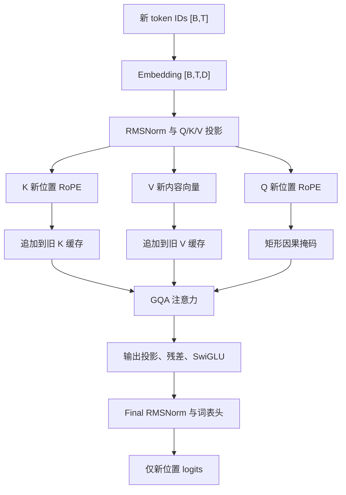

# T15 KV

## 问题

自回归生成每次只新增一个词元（Token）。T14 的生成方式把整个已生成前缀再次送入模型；如果前缀长度从 1 增长到 $N$，每一步都重新计算前面所有位置的键（Key）和值（Value）。KV Cache（Key-Value Cache，键值缓存）保存前面位置已经算好的 K/V，让新位置只计算自己的 Q/K/V，再用新 Query 读取全部历史 K/V。

本任务验证的是**缓存计算与完整前缀重算是否给出同一组 next-token logits（下一词元未归一化分数）**。使用 T13 的单 Decoder Block 小模型和显式 CPU 数值 reference，不使用 Transformers Cache API，也不测加速比。

## 基础

| 名词 | 在本实验中的含义 |
| --- | --- |
| Query（查询，Q） | 当前 token 用来询问上下文的向量；未来位置会产生不同的新 Q，所以当前 Q 只在当前步使用。 |
| Key（键，K） | 每个历史 token 的匹配特征；新 Q 与历史 K 做点积，决定读取各位置的权重。 |
| Value（值，V） | 每个历史 token 携带的内容；注意力权重加权汇总 V 得到当前注意力输出。 |
| Prefill（提示词预填充） | 第一次将完整 prompt（提示词前缀）并行送入模型，得到每个 prompt 位置的 logits，并构造初始 K/V 缓存。 |
| Decode（增量解码） | 每次只把一个新 token 输入模型，读取缓存的历史 K/V，并将这一步新算出的 K/V 追加到缓存。 |
| 位置编码 | T12 使用 RoPE（Rotary Position Embedding，旋转位置嵌入），它用绝对位置旋转 Q 和 K。缓存中的历史 K 已旋转；下一步的 Q 和新 K 使用各自的新绝对位置。 |
| 因果掩码 | Causal Mask（因果掩码）规定 query 位置 $i$ 只允许读取 key 位置 $j\le i$。T12 的布尔掩码约定 `True` 表示允许。 |
| logits | 输出头为词表中的每个 token 给出的原始分数；这里逐元素比较整条向量，不只比较最大分数或最终 token。 |

缓存值的形状为 `K,V: [B,Hkv,N,d]`，位置为 `[B,N]`。`B` 是批大小，`Hkv` 是键值头数，`N` 是累计缓存长度，`d` 是每头宽度。小模型使用 `B=1,Hkv=2,d=2`。GQA（Grouped Query Attention，分组查询注意力）将每个 KV 头共享给一组 Query 头；本实验保存原始 2 个 KV 头，不保存扩展到 4 个 Query 头后的临时副本。

## 全程

数据经过以下真实路径。Prefill 的 `T` 是 prompt 长度；已有缓存时 `T=1`。



### prefill

在 T15 这个实验里，**Prefill（提示词预填充）** 的作用可以用一句话概括：**把用户一开始给的一整段话（Prompt）一次性读完，顺便把这段话的“记忆档案”（初始 KV Cache）建好，并猜出接下来的第一个新词。**


#### 1. 直观比喻：看小说做人物卡片

假设你在看一本侦探小说（生成文本）：

- **没有 KV Cache（T14 的笨办法）：** 每当你翻到新的一页，为了看懂剧情，你都得把前面看过的几十页从头到尾重读一遍。
- **有了 KV Cache（T15 的聪明办法）：**
  - **Prefill 阶段（打底建档）：** 小说一开头直接给了你前 3 章（比如长度为 $P=3$ 的 Prompt）。你**一口气把这 3 章读完**，每章读完顺手写一张“剧情/人物总结卡片”（这就是 **K 和 V**），一共攒了 **3 张卡片**放进盒子里（初始 `KVCache`）。同时，你根据前 3 章的内容，推理出了第 4 章的开头第一句话（输出第一个新 token）。
  - **Decode 阶段（后续单步）：** 接下来你每往下写一句话（每次只输入 $T=1$ 个新 token），不需要重读前 3 章了，直接**翻看盒子里那 3 张卡片**，再把新写的这一句话做成**第 4 张卡片**塞进盒子即可。

#### 2. 在 T15 代码与数据流里，Prefill 具体干了哪三件事？

（以 Prompt 长度 $P=3$ 为例，输入位置是 `[0, 1, 2]`），Prefill 在底层实打实地完成了三个任务：

1. **并行处理整段开头（算得快）：**

   刚开始时，手里还没有任何缓存（`past` 为空），但我们已经有了完整的 3 个初始词（`[1, 3]`）。Prefill 不需要一个词一个词往里蹦，而是直接把这 3 个词打包一起塞进模型，一次性算出它们各自的 $Q, K, V$。

2. **打造“第一桶金”缓存（建好 `N_0 = P` 的底座）：**

   它把这 3 个位置算出来的 $K$（已加上各自位置 0, 1, 2 的 RoPE 旋转）和 $V$ 存下来，打包成长度为 3 的初始 `KVCache`（形状为 `[1, 2, 3, 2]`）。没有这一步攒下的“老底”，后面的单步 Decode 根本没法工作。

3. **给出每一个位置的预测分数（最重要的是最后一个）：**

   Prefill 会输出形状为 `[1, 3, 17]` 的 `logits`。其中，第 0 个位置预测第 1 个词，第 1 个位置预测第 2 个词，而**最后一个位置（位置 2）的 logits，直接决定了模型接下来要生成的第一个全新词元（即位置 3 的 token）是什么**。

#### 3. 为什么非要把 Prefill 和 Decode 分开看？

你可能会问：“不都是往模型里塞 token 吗，为什么要特意起个名叫 Prefill？”

因为它们在数据形状和计算特征上完全不同：

| **对比维度**             | **Prefill（预填充阶段）**                                   | **Decode（增量解码阶段）**                                   |
| ------------------------ | ----------------------------------------------------------- | ------------------------------------------------------------ |
| **发生在什么时候**       | 整个生成任务的**第 1 步**                                   | 第 2 步及以后的**每一步**                                    |
| **一次输入几个词**       | 整段 Prompt 一起进（$T = P$，比如 3 个词）                  | 每次只进刚生成的 **1 个新词**（$T = 1$）                     |
| **进去前有没有旧缓存**   | **没有**（从零开始创建长度为 $P$ 的缓存）                   | **有**（读取旧缓存，并把长度 $+1$）                          |
| **因果掩码（Mask）形状** | **正方形下三角** `[1, 1, P, P]`（防止前面的词偷看后面的词） | **扁平长方形** `[1, 1, 1, P+1]`（1 个新词看前面所有老词+自己） |

简单来说，**Prefill 就是给后续的增量解码（Decode）“铺路搭桥”的启动阶段**——它把开头的已知信息一次性消化掉，变成可复用的 K/V 缓存，好让后面的每一步都能轻装上阵，只算 1 个新词。

一次增量步的轴长变化如下：

| 张量/状态 | Prefill 输入长度 `T=P` | 后续单步输入 `T=1` | 说明 |
| --- | ---: | ---: | --- |
| 新 token IDs | `[1,P]` | `[1,1]` | Decode 调用只传刚追加的 token，不重复传整个 prefix。 |
| 当前隐藏状态 | `[1,P,8]` | `[1,1,8]` | 只对本次输入 token 做 embedding 和 block 计算。 |
| 新 Q | `[1,4,P,2]` | `[1,4,1,2]` | Query 头 `Hq=4`；它不加入缓存。 |
| 新 K/V | 各 `[1,2,P,2]` | 各 `[1,2,1,2]` | KV 头 `Hkv=2`。K 在缓存前已做 RoPE；V 不做 RoPE。 |
| 历史加新 K/V | 各 `[1,2,P,2]` | 各 `[1,2,P+1,2]` | 返回新 cache；传入的旧 cache 不被原地改写。 |
| 掩码 | `[1,1,P,P]` | `[1,1,1,P+1]` | 单步 query 的绝对位置是旧缓存末位置加一，因此可以读取全部历史和当前键。 |
| 当前 logits | `[1,P,17]` | `[1,1,17]` | Decode 返回本次新增 token 对应的分数。 |

以 prompt 长度 `P=3` 为例：prefill 输入位置 `[0,1,2]`，K/V cache 长度为 3；第一个增量步只输入位置 3 的 token，矩形掩码形状 `[1,1,1,4]`，结果 cache 长度为 4。接着位置 4 对应掩码 `[1,1,1,5]` 和 cache 长度 5。代码使用真实位置比较生成 mask，而不是把 `[1,1]` 的 query 当成从位置 0 开始的序列。


### 为何只存 K/V

当前 Query 只负责本轮读取上下文。下一轮会由新 token 的隐藏状态投影出另一个 Query，旧 Query 不会参与未来轮次；因此缓存 Q 没有后续用途。K 和 V 则代表每个历史 token 在这一层中用于“匹配”和“提供内容”的结果，新 Query 必须重复读取它们。如果不缓存 K/V，每一步重放整段 prefix 时就会重新投影并重新计算历史 token 的 K/V。

在本 reference 中 K 缓存的是 **RoPE 旋转后的 K**，因为注意力使用旋转后的键；再次解码时直接复用，避免把旧 K 用位置重复旋转。V 缓存的是投影后的原始内容向量，因为 T12 的 RoPE 只作用于 Q/K。Q 是短暂局部变量，用完即释放；缓存对象由调用者持有并在结束请求时随 Python 对象生命周期释放。

真实多层模型需要**每一层各有 K/V**：每层输入隐藏状态不同，投影权重也不同，本层的 K/V 不能替其他层复用。本任务是单层 reference，故 `KVCache` 只表示这一层；不是多层模型缓存格式。

## 关键选择

1. **绝对位置显式传入。** 不能在 decode 时对新 token 重新使用位置 0。位置错误会同时改变新 Q、新 K 的 RoPE 角度，也会让因果 mask 错认历史范围。本实现要求新位置严格等于 cache 最后位置加一。
2. **缓存 K 保持已旋转状态。** RoPE 在 K 进入 cache 之前执行一次。若缓存未旋转 K，却在复用时不旋转，就会漏掉位置；若对已旋转 K 再旋转，就会重复编码位置。
3. **使用矩形因果 mask。** query 长度为 1、key 长度为 `N+1`。复用普通 `1×1` 下三角 mask 会只允许看到第一列或产生错误对齐；正确条件是 `key_position <= query_position`。
4. **每次返回新缓存。** `torch.cat` 创建包含旧状态和新状态的张量，旧对象仍保持原长度。这使每个调用的状态变化可审计，也避免把同一个新 token 原地 append 两遍。它是清晰的教学 reference，不是预分配静态缓存。
5. **缓存仅接收一个增量 token。** `past` 不为空时，函数拒绝 `T>1`，避免把 multi-token continuation 的 mask、位置和 append 语义悄悄混进单步验收。

## 公式

令当前 query 位置为 $i$，缓存中已有位置为 $0$ 到 $i-1$。注意力需要本轮 query 与所有可见键值共同计算：

$$
\mathrm{Attn}_i=
\mathrm{softmax}\!\left(
\frac{q_i K_{0:i}^{\mathsf T}}{\sqrt{d}}
\right)V_{0:i}
$$

此处 `K_{0:i}`、`V_{0:i}` 包含旧缓存和本步新 token。数学结果与不缓存、重算完整 prefix 相同，因为每个旧位置的 K/V 只依赖该位置及其左侧上下文；因果掩码禁止它读取右侧 token。因而在同一权重、同一 token 序列、同一绝对位置下，旧位置的 K/V 不会因后续 token 到来而改变。

若 `P` 为 prompt 长度、`s` 为已增量解码步数，则期望长度按调用次数递推：

$$
N_0=P,\qquad N_s=N_{s-1}+1=P+s
$$

实现不在循环里把完整 prefix 再传进缓存函数；每一轮只给一个新 token，因此长度不会按 `P+s` 再次整体追加。

## 程序

`kv_cache.py` 提供 `KVCache` 和 `forward_with_cache`。它复用 T13 已训练/初始化的模型权重和 T11/T12 的模块，显式执行该单层的 embedding、归一化、Q/K/V 投影、RoPE、GQA、两处残差和词表输出。函数是无全局状态的：调用者提供 `past` 并接收新 cache；多个请求可并发调用，但不能在推理期间并发修改共享模型参数或传入张量。

`run_t15.py` 固定 seed 1515 和 17 个 token 的人工词表，分别对长度 1、3、5 的 prompt 做 prefill，再各连续 decode 16 步。每一步都用无缓存完整前缀重算同位置 logits，并逐元素断言阈值。原始逐步数据见[实验 JSON](../../../../reports/stage-02/2026-10-17-t15/cache_comparison.json)。测试入口还检查旧 cache 不变和每步只增加一个位置。

从仓库根目录执行：

```bash
.venv/bin/python learning/batches/b05-generation-kv-resources/t15-kv-cache-reference/run_t15.py
.venv/bin/python learning/batches/b05-generation-kv-resources/t15-kv-cache-reference/test_t15.py
```

## 结果

实验运行环境为 CPU、float64、PyTorch 2.11.0+cu128、Python 3.12.3；模型配置 `V=17,D=8,Hq=4,Hkv=2,d=2,F=12`，单层，eval + inference mode。使用 `rtol=0, atol=1e-12`。3 个 prefill 加 48 个 decode 对照，共 51 条位置级记录；最大 logits 绝对误差为 `2.220446049250313e-16`。每个 prompt 都覆盖 16 次连续单 token decode，cache 长度从 `P` 增长到 `P+16`，未重复增长。2 项 T15 测试通过。

| Prompt 长度 | Prefill cache | 16 步后的 cache | 最大 logits 绝对误差 |
| ---: | ---: | ---: | ---: |
| 1 | 1 | 17 | `2.220446049250313e-16` |
| 3 | 3 | 19 | `2.220446049250313e-16` |
| 5 | 5 | 21 | `2.220446049250313e-16` |

该结果证明这组 float64 CPU reference 下的数值一致性，不是逐位相同，也不构成 GPU、低精度、反向传播、长上下文、真实权重或性能结论。每一步仍通过 `torch.cat` 重新分配增长后的 reference cache；本实验没有测量这类复制的成本，也没有验证生产 Dynamic/Static Cache 的内存管理。

## 资料

- R05：[Llama 文档](https://huggingface.co/docs/transformers/main/en/model_doc/llama)与 [Llama attention 实现](https://github.com/huggingface/transformers/blob/main/src/transformers/models/llama/modeling_llama.py)。本任务核对 Q/K/V 投影、对 Q/K 应用位置旋转、追加 `past_key_values` 后参与 attention 的执行顺序；网页与 `main` 分支为滚动版本，核对日期 2026-10-17。实验代码复用 T13 的小型实现，不导入 Transformers。
- R06：[Cache explanation](https://huggingface.co/docs/transformers/main/en/cache_explanation)与 [KV Cache strategies](https://huggingface.co/docs/transformers/main/en/kv_cache)。本任务范围为自回归 cache、cache length、绝对位置和带历史的因果 mask；官方 API 的具体参数与本地 tuple reference 不等同。核对日期 2026-10-17。
- 本地先修：[T12 RoPE/GQA/位置](../../b04-decoder-block/t12-rope-gqa-position/README.md)、[T13 小 Decoder 前向](../../b04-decoder-block/t13-small-decoder-forward/README.md)、[T14 逐 token 生成](../t14-tiny-lm-training-generation/README.md)。

## 边界

- 单层、batch size 1 的固定 token 流；代码接口支持 batch，但本组实验没有验证多样本 batch、补齐/变长请求或并发调度。
- 只测 CPU float64。PyTorch wheel 支持 CUDA 不等于本实验已跑 GPU。
- 无模型训练或外部权重；无 tokenizer、采样、EOS、位置缩放、滑动窗口、缓存淘汰、beam branching、cache crop/rollback。
- 不做性能或内存测量；不把数学上避免历史重算直接写成已实测加速。
