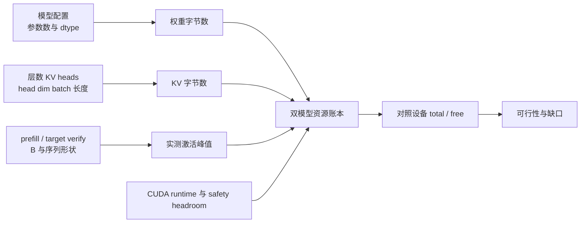

# T16 显存预算

## 问题

T15 已验证单层 KV Cache 的 logits 正确性。T16 把问题扩展到资源容量：模型权重常驻多少、target/draft 两套模型分别保存多少 KV、一次 prefill 或验证前向需要多少临时空间，以及 PyTorch 显示的 allocated 和 reserved 如何解释。

本章分开做两件事：一是用 T13 小模型在 GPU 上实测两个模型、K/V 张量和前向峰值；二是用明确标注的假设模型配置计算双模型容量场景。小模型实测验证计量路径，不用于推断 7B 模型的显存峰值。

## 基础

| 名词 | 本章含义 |
| --- | --- |
| 参数（Parameter） | 模型权重中可训练或已训练的数值。推理时参数通常保持常驻 GPU。 |
| KV Cache | 每层按 token 保存的 Key（键）和 Value（值）。T15 的单层缓存沿用该定义。 |
| dtype | Tensor 数据类型。float32 每元素 4 byte，float16/bfloat16 每元素 2 byte；实际参数和 cache dtype 可能不同，因此公式应分别传入字节数。 |
| allocated | PyTorch caching allocator 当前分配给存活 Tensor 的显存字节数。 |
| reserved | PyTorch caching allocator 向 CUDA 申请并仍管理的内存池总量，其中包含 allocated 的活动区和可复用的空闲区。它与 allocated 是包含关系，不能相加。 |
| free / total | CUDA 设备当前可用显存及设备总显存。它受其他进程、桌面显示和 CUDA context 影响；与 PyTorch 进程内 allocator 指标不是同一口径。 |
| activation | 一次前向在算子之间产生的隐藏状态、注意力分数、MLP 中间结果和输出等临时 Tensor。它通常随执行阶段而变化，并非所有中间 Tensor 同时存活。 |
| GiB / GB | GiB 使用 $2^{30}$ byte，GB 使用 $10^9$ byte。本章容量表使用 GiB，原始审计数据保留 byte。 |

## 预算式

### 权重

设 $P$ 为参数个数，$b_w$ 为每个参数的字节数：

$$
M_{\mathrm{weight}}
\overset{\text{参数逐个占 }b_w\text{ 字节}}{=}
P b_w
$$

target 和 draft 是两套独立参数时，必须分别计数后相加，不能因为它们处理同一个请求而共用权重预算。本章的容量例子只按未量化 BF16 参数计算，不包含 optimizer 状态、梯度或训练显存。

### KV Cache

设 $L$ 为层数、$B$ 为 batch size、$H_{kv}$ 为 KV 头数、$d_h$ 为每头宽度、$S$ 为本次预算的最大 cache 长度、$b_{kv}$ 为每个 KV 元素字节数。每个 token、每层、每个 KV 头都保存一条 K 和一条 V：

$$
M_{\mathrm{KV}}
\overset{\text{K 与 V 两份}}{=}
2 L B H_{kv} S d_h b_{kv}
$$

若 target 和 draft 的架构、精度或 cache 长度不同，则分别代入各自配置：

$$
M_{\mathrm{KV,total}}
\overset{\text{两套状态各自驻留}}{=}
M_{\mathrm{KV,target}}+M_{\mathrm{KV,draft}}
$$

`S` 应取峰值而不是平均长度。Speculative Decoding（推测解码）中，draft 可能先产生一组候选，target 在验证期间需要历史上下文和候选位置；预算可把 `context + verify_tokens` 作为保守 cache 长度。实际系统是否保留被拒绝的候选、如何裁剪缓存，取决于具体实现，本例只做容量预留。

### 激活

激活没有一个只由参数量决定的统一常数。它还依赖 batch、上下文长度、验证 token 数、query heads、前馈宽度、attention 实现、dtype 和临时 Tensor 是否融合。显式 attention 的分数矩阵单项字节数可用下面的形状量级检查：

$$
M_{\mathrm{scores}}
\overset{\text{元素数乘每元素字节}}{=}
B H_q T_q T_k b_s
$$

其中 $T_q$ 是当前 query token 数，$T_k$ 是可见 key 长度，$b_s$ 是分数矩阵实际 dtype 的字节数。对逐层执行的模型，不应把所有层的分数矩阵都默认当成同时存活；融合 attention 又可能根本不显式 materialize 完整矩阵。故本实验通过 `max_memory_allocated()` 测量实际 reference 前向峰值，并把它称作本 workload 的实测额外 active peak，不声称是通用 activation 公式。

## 账本

显存预算把运行模型需要的占用分为可解释的组成：

$$
M_{\mathrm{budget}}
\overset{\text{固定状态加峰值临时区与预留}}{=}
M_{w,t}+M_{w,d}+M_{kv,t}+M_{kv,d}+M_{act}+M_{runtime}+M_{headroom}
$$

这里 `runtime` 留给 CUDA context、kernel/workspace 和框架状态；`headroom` 是防止设备被填满的容量余量。`memory_reserved` 用于观察 allocator 池的实际规模，不是要再加在上式上的独立 Tensor 类别。PyTorch 文档明确区分 live tensor 的 allocated 与 allocator 管理的 reserved；`nvidia-smi` 还会显示 allocator 留存的空闲块和其他进程占用。

完整数据路径如下：



## 实验

### 设备与 workload

执行脚本在当前设备 `NVIDIA GeForce RTX 5080 Laptop GPU` 上工作。使用两个独立的 T13 小模型模拟 target 与 draft：target 配置 `V=17,D=8,Hq=4,Hkv=2,F=12`，draft 只把 `Hkv` 改为 1；两者均为单层 float32 推理模型。KV 样本使用 `B=2,S=128`，分别按两个模型的 KV head 数分配 K 和 V。

脚本先记录设备 free/total，然后把双模型放到 CUDA；随后分配两组 K/V；最后测 target 的 `B=2,S=128` prefill，以及 `B=2,S=133` 的完整前缀验证参考。测 activation 时先 warm up 一次 CUDA backend，再清理输出，之后重置 peak 统计。这样 persistent workspace 留在 steady baseline 中，不把首次初始化全部算成单次 activation。

`S=133` 表示 128 个 context 加 5 个候选位置。这次验证调用仍是 T13 的 full-prefix reference，并没有实现“读取历史 cache、只对 5 个候选做 target forward”的多 token cache 验证路径；它仅提供一个可实测的上界 proxy。

### 观测

完整 byte 级数据保存于[原始 JSON](../../../../reports/stage-02/2026-10-17-t16/budget_measurements.json)。设备可用量会随其他进程变化，以下是本次运行采样，不是固定机器规格承诺。

| 观测项 | 公式/张量逻辑字节 | 实测 allocator 或设备值 | 解释 |
| --- | ---: | ---: | --- |
| 双模型参数 | 6,080 B | model load 后 allocated 14,336 B | 参数 Tensor 本身为 3,104 + 2,976 B；另有 8,256 B 活动分配未能从参数张量归属。不能把差额伪称为权重。 |
| 双模型 K/V | 12,288 B | 新增 allocated 12,288 B；K/V Tensor `nbytes` 也为 12,288 B | target 8,192 B，draft 4,096 B，公式与实际 Tensor 大小相等。 |
| allocator reserved | 不由模型公式推导 | 权重后 2 MiB；K/V 后 2 MiB；前向 peak 22 MiB | reserved 是 allocator 池尺寸，包含活动分配并有粒度/空闲块，不能加到 allocated 上。 |
| Prefill 前向峰值 | 不采用单一理论数 | steady baseline 上增加 1,163,264 B（约 1.108 MiB） | B=2、S=128 的测量，含输出 logits 和该调用仍活跃的临时值。 |
| Verifier reference 峰值 | 不采用单一理论数 | steady baseline 上增加 1,256,960 B（约 1.199 MiB） | B=2、S=133 full-prefix reference；不等价于真实 speculative cache verifier。 |
| CUDA 设备容量 | — | total 17,094,475,776 B；开始时 free 15,685,648,384 B | 其余显存当时由其他进程/context 等占用；后续读取的 free 值会波动。 |

小模型中参数公式只算出了权重 Tensor 的逻辑字节数，而 active allocated 高出 8,256 B。运行时额外分配可能来自 CUDA/PyTorch backend 初始化或工作区；本脚本没有按指针归因，所以保留为“未归属 active bytes”。CUDA allocator 在权重加载后已保留 2 MiB，而活动 Tensor 仅约 14 KiB；这反映了 allocator 块粒度和复用机制，不是实际权重突然扩大了数百倍。

Verifier reference 比 prefill 多约 92.5 KiB 的 steady peak。它的序列只多 5 个位置，且 toy model 的参数和 attention 矩阵都很小；不能据此按固定比例外推到真实 7B 模型。R19 第 3 章强调 prefill 与 decode 的输入行数、调用顺序和状态驻留不同；这里的双模型、长 cache 和 target 验证激活必须分别计入，而不能把一次 token 的成本当成整条请求峰值。

## 双模型例

为说明容量预算，另计算一个**纯假设配置**：target 7B 参数、32 层、8 个 KV heads、`d_head=128`；draft 1B 参数、24 层、8 个 KV heads、`d_head=64`；权重与 KV 均按 BF16（每元素 2 B），context 为 4,096 token，验证空间预留 5 token。该配置不是实际加载或验证过的模型。设备 total 使用本次 RTX 5080 读数 15.920 GiB。

| Batch | Target 权重 | Draft 权重 | Target KV | Draft KV | 验证激活预留 | Runtime + safety 预留 | 预算合计 | 对本机 total 的缺口 |
| ---: | ---: | ---: | ---: | ---: | ---: | ---: | ---: | ---: |
| 1 | 13.039 GiB | 1.863 GiB | 0.501 GiB | 0.188 GiB | 2.000 GiB | 1.592 GiB | 19.182 GiB | 3.261 GiB |
| 2 | 13.039 GiB | 1.863 GiB | 1.001 GiB | 0.375 GiB | 2.000 GiB | 1.592 GiB | 19.870 GiB | 3.949 GiB |
| 4 | 13.039 GiB | 1.863 GiB | 2.002 GiB | 0.751 GiB | 2.000 GiB | 1.592 GiB | 21.247 GiB | 5.326 GiB |

`Runtime + safety` 取设备 total 的 10%（1.592 GiB），`验证激活`另设 2 GiB 工作预算。2 GiB 不是 toy forward 的外推值，也不是硬件实测；它是要为 target 批量验证的临时 Tensor、backend workspace 和未建模框架占用留下独立空间的显式规划输入。目标模型结构/attention backend 确定后，应用相同峰值方法实测替换。即使 batch=1，预算也超过整张卡 total；按审计开始时 free 14.608 GiB 计算，缺口更大。因此这组双模型+上下文+余量不能装入当前设备。

## 复现

从仓库根目录运行：

```bash
.venv/bin/python learning/batches/b05-generation-kv-resources/t16-memory-budget/budget_experiment.py
```

脚本会检查 CUDA 是否可用，输出模型参数逻辑字节、实际 active allocated/reserved、K/V 公式和实际 Tensor 字节、prefill/verifier forward 峰值，以及假设双模型容量表。原始输出可按同一命令重建。

## 边界

- 小型实测是 T13 单层 float32 模型、batch 2、长度 128/133；只用于验证公式与 PyTorch/CUDA 观测口径。
- toy verifier 是完整前缀前向，不是多 token cache 验证 kernel；峰值不能直接代表真实 target/draft 引擎。
- hypothetical 7B+1B 表格仅是输入假设的容量计算，不是加载模型的实验结果，也不意味着特定模型具备该层数/head 配置。
- 不含量化元数据、权重 staging、optimizer/梯度、CUDA Graph 私有池、通信缓冲、分页 KV 碎片或其他应用工作负载；这些需要按目标运行时补测。
- `reserved` 是 allocator 池口径，不与 `allocated` 求和；设备 free/total 口径含共享 GPU 上其他进程影响。

## 资料

- R06：[Cache explanation](https://huggingface.co/docs/transformers/main/en/cache_explanation)、[Cache strategies](https://huggingface.co/docs/transformers/main/en/kv_cache)。核对每层 K/V cache、随 token 增长、mask 覆盖 past+current 的维度关系；在线 `main` 文档于 2026-10-17 查看，API 版本会变化。
- R19：[第 1 章](https://bojieli.github.io/ai-infra-book/manuscripts/01-%E5%88%9D%E8%AF%86%20AI%20Infra.html)的容量/带宽/单次执行估算；[第 3 章](https://bojieli.github.io/ai-infra-book/zh-tw/chapter03.html)的 prefill/decode 负载、上下文长度和状态驻留。于 2026-10-17 核对，书稿持续修订。
- R21 本地回查：[03-显存三分账](../../../LLM推理服务技术详解/03-显存三分账.md)。复核参数字节、KV 逐层逐 token 公式、GQA 的 KV head 影响及 GB/GiB 换算；本章在此基础上补入双模型、激活、allocator 和设备余量。
- PyTorch：[CUDA memory management](https://docs.pytorch.org/docs/stable/notes/cuda.html)及 [`memory_allocated`](https://docs.pytorch.org/docs/stable/generated/torch.cuda.memory_allocated.html)、[`memory_reserved`](https://docs.pytorch.org/docs/stable/generated/torch.cuda.memory_reserved.html)。用于区分 live tensor 与缓存 allocator 管理量；核对日期 2026-10-17，stable 文档随版本更新。
